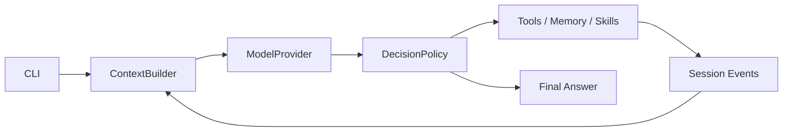

  
  

    Open source · learn by building

    # Leogent

    A small agent runtime you can read, run, and reshape. Follow one request
    from the CLI through model calls, tools, sessions, memory, and context
    compaction.

    [开始学习](tutorials/index.md){ .md-button .md-button--primary }
    [查看源码](https://github.com/Navigateh/Leogent){ .md-button }
  

## 为什么是 Leogent

Leogent 把 Agent 拆成可以单独阅读和替换的组件。第一阶段以教学为主，
第二阶段再把这些组件发展为可长期使用的 coding agent。

| 目标 | 设计方式 |
| --- | --- |
| 看懂完整流程 | 从 CLI 输入一直追踪到最终模型回答 |
| 理解 Agent 算法 | Decision、Context、Compression 等策略可独立替换 |
| 运行真实任务 | MCP 工具、Session、长期记忆和本地模型均使用真实接口 |
| 继续做研究 | Mock Provider、事件日志和回放让算法对比可复现 |

## 请求如何流动

## 学习路线

教程按 Milestone 展开。每个 Milestone 对应一个章节，每个实现点对应一个
子章节，并包含 Leogent 实现、Hermes 对照、运行轨迹和实验。

[进入教程目录](tutorials/index.md){ .md-button }

!!! warning "第一阶段没有沙箱"
    Leogent 当前假定模型和 MCP Server 运行在可信环境中。不要把未知工具或
    不可信模型直接暴露给重要文件。
