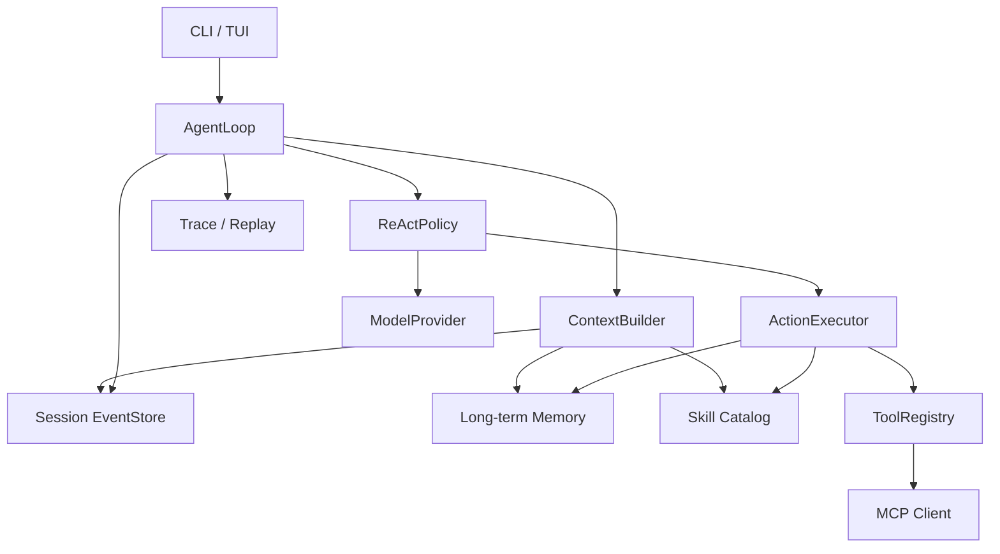

# Leogent 第一阶段设计

**日期：** 2026-10-28

**状态：** 待用户评审

## 1. 项目目标

Leogent 是一个用 Python 编写的开源 Agent 学习框架。项目分两个阶段：

1. 第一阶段提供一个代码量可控、可以完整运行、可以逐层阅读的 Agent 流程，让没有 Agent 开发经验的读者理解模型调用、工具调用、Agent Loop、Session、Memory、上下文压缩和 Skill 加载。
2. 第二阶段扩展为可长期使用的 coding agent，并加入可比较的 Agent 搜索、上下文压缩、局部模型推理和长上下文实验。

第一阶段不是产品化 coding agent 的最终形态，也不追求覆盖所有 Agent 场景。它的核心验收标准是：读者能够从一次 CLI 输入出发，沿真实代码路径理解一次完整 Agent 运行，并能修改其中一个策略观察行为变化。

## 2. 第一阶段范围

### 2.1 必须完成

- Python 包、CLI 和可安装的本地开发环境。
- 统一的模型 Provider 接口。
- OpenAI-compatible 云服务和本地服务接入。
- 可选的 Hugging Face Transformers 本地模型接入。
- MCP 工具发现和调用。
- ReAct Agent 策略。
- append-only Session 事件日志。
- Session 创建、恢复、列出和 fork。
- SQLite 短期会话存储和长期记忆存储。
- 基础长期记忆写入、检索和删除。
- 动态上下文构造和一种滚动摘要压缩策略。
- Skill 发现、目录索引和按需加载。
- 流式 CLI 和基础 TUI。
- 可录制的 Mock Provider、轨迹回放和默认离线测试。
- 面向初学者的架构文档与分步教程。

### 2.2 明确不在第一阶段

- OS、容器、虚拟机级沙箱隔离。
- 文件、进程或网络的强制权限边界。
- 工具审批作为安全机制。
- 多 Agent 编排和 Web UI。
- 分布式任务队列和远程 Session 服务。
- 自动长期记忆蒸馏。
- Plan-and-Execute、Reflexion、搜索 Agent 等额外策略。
- 高级上下文压缩算法。
- RoPE 外推、YaRN 和底层 KV cache 管理。
- 完整 coding agent 产品化和插件市场。

### 2.3 安全假设

第一阶段假定用户在可信的本地环境中运行可信的模型和 MCP Server。Runtime 会记录并展示工具调用，但这个记录不是安全边界。

第一阶段不提供沙箱、降权执行、网络出口控制或强制工具审批。README 必须明确提醒用户：MCP Server 和模型可以访问当前进程拥有的文件和系统权限。沙箱与权限模型属于第二阶段。

## 3. 设计原则

### 3.1 事件日志是事实来源

用户消息、模型响应、工具调用、工具结果、上下文压缩、记忆操作、错误和结束原因都以事件形式追加到 Session。内存中的消息列表只是运行时视图，不是可恢复状态的唯一来源。

### 3.2 上下文是每轮构造的投影

系统提示词、历史事件、压缩摘要、长期记忆和 Skill 都由 `ContextBuilder` 按策略选择并排序。每次构造生成可追踪的 `ContextPlan`，用于解释哪些内容进入了模型请求。

### 3.3 算法通过协议替换

Agent Loop 只负责驱动状态转移。下一步如何决策、如何选择上下文、何时压缩、何时结束分别由独立策略负责。教学策略可以很小，未来的算法实验不需要复制 Runtime。

第一阶段只实现 ReAct，但 Plan-and-Execute 等策略应当能够复用 Provider、Tool、Memory、Session 和 CLI。

### 3.4 外部能力与内部动作分离

文件、Shell、Git、网络等外部能力通过 MCP 接入。`remember`、`search_memory`、`load_skill` 和 `finish` 属于 Runtime 的内部控制动作，使用统一 Action 表示，不伪装成 MCP Server。

### 3.5 模型推理与 Agent 编排分离

KV cache、RoPE、YaRN 和批处理属于模型推理层。第一阶段只保证 Agent 产生的 prompt 结构稳定、支持流式输出并允许 Provider 上报缓存使用情况。Agent 不读取、复制或操作模型的 KV cache。

## 4. 总体架构



### 4.1 组件职责

- `domain`：不依赖基础设施的数据模型和协议。
- `runtime`：Agent Loop、RunState、预算、错误和终止条件。
- `policies`：决策策略，第一阶段包含 ReAct。
- `context`：上下文计划、预算、压缩和工具输出截断。
- `providers`：模型 API 和本地模型适配器。
- `tools`：Action 执行、工具注册和 MCP 接入。
- `memory`：长期记忆的写入、检索和删除。
- `skills`：Skill 发现、索引和按需加载。
- `sessions`：事件持久化、恢复和 fork。
- `cli`：命令入口、TUI、渲染和主题。

组件之间通过小型协议和领域对象通信。Provider 和 MCP 的原始响应不能直接泄漏到 Agent Loop。

## 5. 核心领域模型

第一阶段至少定义以下对象：

- `Message`：role、content 和可选结构化内容。
- `ModelRequest`：消息、工具描述、生成参数和上下文元数据。
- `ModelResponse`：文本、工具调用、结束原因和 usage。
- `Action`：`call_tool`、`load_skill`、`remember`、`search_memory`、`finish`。
- `ToolCall`：工具名、参数、调用 ID。
- `ToolResult`：成功或失败的归一化结果。
- `Event`：事件 ID、Session ID、序号、时间、类型和 payload。
- `Session`：ID、创建时间、父 Session、fork 位置和当前状态。
- `MemoryItem`：类型、内容、scope、来源、置信度和时间信息。
- `SkillDescriptor`：名称、描述和资源清单。
- `ContextPlan`：被选中的事件、记忆、Skill 和预算分配。
- `RunState`：当前步骤、终止原因、累计 usage 和预算状态。

领域对象使用 Pydantic 校验，时间统一使用 UTC，序列化格式必须稳定。

## 6. Session 与事件

### 6.1 事件类型

第一阶段使用以下核心事件：

- `session_started`
- `user_message`
- `model_request`
- `model_response`
- `action_requested`
- `tool_completed`
- `memory_written`
- `memory_retrieved`
- `skill_loaded`
- `context_compacted`
- `run_finished`
- `run_failed`

事件 payload 只保存恢复和回放所需内容。模型原始响应可作为可选调试字段，但默认不保存敏感请求头。`memory_written` 和 `memory_deleted` 只保存记忆 ID、类型、scope 和操作元数据，不保存记忆正文；正文以 `memory_items` 表中的当前数据为准。

### 6.2 Session 生命周期

- `create`：创建 Session 并写入开始事件。
- `resume`：读取事件并重建 RunState。
- `list`：列出 Session、时间、模型和摘要。
- `fork`：复制指定事件以前的历史，建立新的 Session ID。

Session 状态分为 `active`、`completed`、`failed` 和 `cancelled`。进程异常退出时，恢复逻辑能从最后一个有效事件继续，而不是假设 Session 一定正常关闭。

### 6.3 持久化

第一阶段只提供 SQLite Store。数据库表至少包括：

- `sessions`
- `events`
- `memory_items`
- `schema_versions`

事件使用自增整数作为 Session 内排序键，同时保留 UUID 供外部引用。数据库写操作使用事务，工具完成事件和对应的 Session 元数据更新必须在同一事务中提交；RunState 始终由事件重建。

## 7. Memory

### 7.1 四种状态

| 状态 | 生命周期 | 位置 |
| --- | --- | --- |
| Working Context | 单次模型请求 | 内存 |
| Session Event Log | 单个 Session | SQLite |
| Long-term Memory | 跨 Session | SQLite |
| Artifacts | 由外部系统决定 | 文件系统或外部服务 |

短期记忆就是 Working Context，不额外写入一张“短期记忆表”。

### 7.2 长期记忆类型

- `semantic`：稳定事实，例如项目语言、目录约定。
- `episodic`：过去完成的任务、结果和失败。
- `procedural`：可复用的操作经验。
- `preference`：用户明确表达的偏好。

每条记忆包含内容、类型、scope、来源事件 ID、置信度、创建时间、最近访问时间和可选过期时间。第一阶段支持 `project` 与 `global` 两种 scope。第一阶段不自动推断用户偏好；写入必须经过明确的 Runtime Action 或应用调用，便于观察和测试。

### 7.3 检索

默认检索结合 SQLite FTS5 相关度、最近访问时间和记忆类型排序，然后根据上下文预算截取。Embedding 检索不在第一阶段实现，但 Memory 接口允许后续加入不同 ranker。

删除操作必须是真实删除，并同时清除对应的 FTS 索引。Session 事件中保留“曾经写入和删除过记忆”的审计记录，但不应让已删除正文继续可检索。

## 8. 上下文与压缩

### 8.1 ContextBuilder

每次模型请求前按以下顺序构造上下文：

1. 固定系统规则。
2. 当前用户请求。
3. 尚未闭环的工具调用及其结果。
4. 最近事件窗口。
5. 压缩摘要。
6. 检索到的长期记忆。
7. 已选择 Skill 的正文和必要资源。

最终顺序由策略决定，但系统规则、当前请求和未完成 Action 不得被截断。`ContextPlan` 记录每一段的来源、估算 token 和截断原因。

### 8.2 预算

第一阶段使用可替换的 token 估算器。配置包含：

- `context_window`
- `reserved_output_tokens`
- `compaction_threshold`
- `recent_event_limit`
- `tool_output_limit`

默认压缩阈值为可用上下文预算的 75%。Provider 提供 tokenizer 时使用精确 token 数，否则使用保守字符估算。

### 8.3 RollingSummaryPolicy

第一阶段只实现一种完整基线：

- 保留固定系统规则、当前用户请求、未完成工具调用和最近事件。
- 对中间事件生成结构化摘要。
- 摘要包含目标、已完成事项、关键决定、涉及文件、未完成任务和已知错误。
- 生成 `context_compacted` 事件，记录源事件范围、摘要、Provider 和 token 估算。
- 原始事件永久保留。
- 摘要 Provider 失败时，本轮回退到最近事件窗口并生成 `run_failed` 或明确的压缩失败事件；不得删除或覆盖原始事件。

对话压缩、工具输出截断和长期记忆写入是三个独立组件。压缩不自动把摘要写入长期记忆。

## 9. 模型 Provider

### 9.1 接口

Provider 接收标准化的 `ModelRequest`，返回 `ModelResponse`，并支持可选流式 chunk。上层不依赖厂商 SDK 的原始响应对象。

Provider 声明 `ModelCapabilities`：

- `context_window`
- `supports_native_tools`
- `supports_streaming`
- `supports_structured_output`
- `supports_prompt_cache`
- `tokenizer`

### 9.2 第一阶段实现

1. **OpenAI-compatible HTTP Provider**

   覆盖 OpenAI、Anthropic 兼容网关，以及 vLLM、Ollama、LM Studio、llama.cpp server 和 SGLang 等本地 OpenAI-compatible 服务。

2. **Anthropic 原生 Provider**

   实现第一阶段需要的消息、流式输出和工具调用，不复制完整厂商 SDK 能力。

3. **Transformers Provider**

   从本地路径加载 Hugging Face 模型，支持 `chat_template`、`device`、`dtype` 和生成长度配置。重型依赖通过 `leogent[local]` optional extra 安装。

### 9.3 工具调用降级

支持 native tool calling 的模型直接生成结构化 `tool_calls`。不支持或支持不稳定的模型使用受约束的 JSON Action 协议，由 Runtime 解析并经过 Pydantic 校验。ReAct 示例必须演示两种模式。

### 9.4 配置

使用命名 provider profile。第一阶段只支持环境变量密钥引用，不允许把真实密钥写入项目配置。

```json
{
  "default_provider": "local-qwen",
  "providers": {
    "cloud": {
      "type": "openai-compatible",
      "base_url": "https://api.example.com/v1",
      "api_key_env": "LEOGENT_API_KEY",
      "model": "model-name"
    },
    "local-qwen": {
      "type": "transformers",
      "model_path": "/models/Qwen",
      "device": "auto",
      "dtype": "auto"
    }
  }
}
```

## 10. MCP 工具

第一阶段使用官方 Python MCP SDK，实现 `stdio` transport。工具名带 server namespace，例如 `filesystem__read_file`，避免不同 Server 之间的名称冲突。

ToolRegistry 负责：

- 从 MCP 获取工具描述和 JSON Schema。
- 调用前校验参数。
- 调用后归一化文本、结构化内容和错误。
- 统一超时、取消和异常转换。
- 截断过长输出，并记录截断前后大小。
- 记录 server、tool、耗时和调用结果摘要。

示例配置优先选择官方参考 MCP Server，并固定经过验证的版本。仓库不维护 MCP Server 大全，也不复制第三方 Server 的实现。

第一阶段不实现沙箱、进程隔离、降权执行、网络出口控制或强制审批。工具调用会显示在 CLI 中，但用户必须理解它不等于受保护执行。

## 11. Skill

Skill 使用目录结构：

```text
skills/
  code-review/
    SKILL.md
    references/
      checklist.md
```

`SKILL.md` 使用 YAML frontmatter 保存名称、描述、版本和可选资源声明。启动时只建立轻量目录，模型选择 Skill 或应用明确请求后才加载正文。

Skill 加载产生事件，并受大小、编码和重复名称检查。资源读取使用相对于 Skill 根目录的安全路径规范化，但第一阶段不宣称这构成沙箱。

Skill 可以提供流程、领域知识和检查清单，也可以声明推荐工具，但不能直接修改 Runtime 规则。

## 12. CLI 与 TUI

主命令使用 `leogent`。

第一阶段命令：

```text
leogent chat
leogent run "inspect this repository"
leogent run "fix the failing test" --json
leogent resume <session-id>
leogent sessions list|show|fork
leogent tools list
leogent skills list
leogent config show
leogent doctor
```

TUI 采用滚动式终端界面，不使用全屏 Dashboard。品牌符号暂定 `◈`，只通过亮度、颜色和状态文字表示运行状态。

```text
◈ Leogent · ~/project · main*
session 01HT...  qwen2.5-coder:7b

you
给 HTTP client 增加重试。

◈
我先检查当前实现。

  tool   filesystem__read_file
  path   src/client.py
  result 42 lines · 0.03s

◈ running · context 31% · 12.4k/32k · 4.2s
```

实现使用 `prompt_toolkit` 管理输入、历史和补全，Rich 负责流式文本、Markdown、代码高亮和状态渲染。Runtime 产生标准化 UI 事件，TUI 不持有 Agent 状态。

支持 `NO_COLOR` 和 ASCII fallback。`run --no-tui` 与 `run --json` 不依赖交互终端。

## 13. 配置与存储路径

配置采用全局配置和项目覆盖：

- 全局配置：系统用户配置目录。
- 项目配置：`.leogent/config.json`。
- 密钥：环境变量引用。
- Session 与长期记忆：系统用户数据目录。
- 临时运行数据：可配置的临时目录。

`LEOGENT_HOME` 可以覆盖数据目录。仓库默认忽略本地数据库和密钥配置。

## 14. 文件结构

```text
Leogent/
├── pyproject.toml
├── todolist.md
├── src/leogent/
│   ├── domain/
│   ├── runtime/
│   ├── policies/
│   ├── context/
│   ├── providers/
│   ├── tools/
│   ├── memory/
│   ├── skills/
│   ├── sessions/
│   ├── config/
│   └── cli/
├── tests/
│   ├── unit/
│   ├── integration/
│   ├── e2e/
│   └── fixtures/
├── examples/
├── skills/
└── docs/
```

每个 Python 文件保持单一职责。Domain 不导入 Provider、CLI、SQLite 或 MCP 实现。Runtime 不导入具体 Provider 类。

## 15. 测试策略

### 15.1 默认离线测试

- Domain 模型验证和序列化测试。
- ContextBuilder 预算、排序和截断测试。
- RollingSummaryPolicy 保留约束和源事件范围测试。
- SQLite EventStore 恢复、事务和 fork 测试。
- Memory 写入、FTS 检索、scope 和删除测试。
- Provider 请求转换和响应归一化测试。
- Mock MCP transport 的工具发现、错误和超时测试。
- ReActPolicy 的固定轨迹测试。
- TUI Renderer 快照和 `NO_COLOR` 测试。

### 15.2 回放测试

Mock Provider 从 fixture 读取模型响应序列，记录发送给 Provider 的标准请求和生成的标准 Action。固定输入、配置和事件日志应产生相同轨迹。回放用于学习和算法比较，不保存真实密钥。

### 15.3 真实集成测试

真实云模型、本地模型和 stdio MCP Server 测试使用 `live` 标记，默认不进入 CI。`doctor` 命令检查配置、数据库写权限、MCP 启动、模型连通性和上下文配置。

## 16. 教学路径

文档按以下顺序组织，每章链接真实源文件并提供可运行实验：

1. 安装、配置和第一次模型请求。
2. 从 `ModelResponse` 到工具调用。
3. ReAct Loop 的完整执行路径。
4. Session 事件、恢复和 fork。
5. Working Context 与长期记忆。
6. 上下文预算、工具截断和滚动摘要。
7. Skill 按需加载。
8. OpenAI-compatible、本地服务和 Transformers Provider。
9. 录制、回放和替换一个 Agent 策略。

教程使用同一条任务轨迹贯穿，避免每章出现互不相关的玩具示例。

## 17. 验收标准

第一阶段完成时必须满足：

1. 新用户按 README 可以初始化配置、运行 `doctor` 并完成一次对话。
2. Agent 能通过 MCP 读取文件、修改文件并执行测试。
3. 长上下文触发压缩后，原始事件、摘要和当前任务状态均正确保留。
4. 退出后通过 Session ID 恢复，事件顺序和未完成状态保持一致。
5. 从已有事件位置 fork 后，两条 Session 可以独立继续。
6. Skill 初始只出现描述，选择后才加载正文和资源。
7. 同一 ReAct Runtime 可以切换 OpenAI-compatible 云服务、本地 OpenAI-compatible 服务和可选 Transformers 模型。
8. 模型不支持 native tools 时，JSON Action 降级路径可以完成同一任务。
9. Mock 回放能展示一次完整 Agent 轨迹，默认测试不访问网络。
10. 未学过 Agent 的读者可以沿文档从 CLI 输入追到模型、工具、事件和最终回答。

## 18. 第二阶段接口预留

第一阶段不实现但必须保留稳定扩展点：

- `DecisionPolicy`：接入 Plan-and-Execute、Reflexion 和搜索策略。
- `ContextPolicy`：接入高级上下文压缩和检索算法。
- `MemoryRanker`：接入 Embedding 或其他相关度模型。
- `ModelProvider`：接入原生本地模型和不同推理引擎。
- `TraceStore`：接入更完整的评测、回放和算法比较。
- `ToolRuntime`：在不改动 Agent Loop 的前提下增加沙箱和执行策略。
