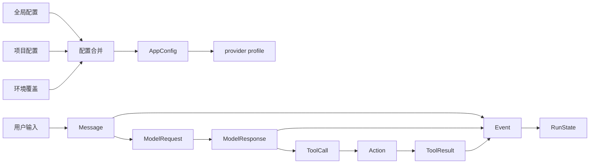

# Milestone 1 · 领域模型与配置

Milestone 0 建立了 Python 包、测试入口和 CLI 骨架。Milestone 1 开始建立
Agent 内部真正共享的语言：消息如何表示，模型如何返回工具调用，一次运行如何
记录状态，配置从哪里加载，以及密钥为什么只能通过引用出现。

这一章不会运行 Agent Loop。它要完成的是更基础的一步：让后续 Provider、
Session、Memory、Skill 和 Runtime 在同一个稳定的数据契约上开发。

## 学习目标

读完后，你应该能够：

- 从配置文件和一次模拟模型响应出发，构造本章定义的领域对象；
- 解释为什么 Leogent 在边界处使用严格 Pydantic 模型；
- 分辨 Event、Session、RunState 和 TerminationReason 各自表示的层级；
- 理解 `ContextPlan` 是上下文构造记录，而不是模型请求本身；
- 解释全局配置、项目配置和环境覆盖的实际优先级；
- 说明 `api_key_env` 为什么只保存变量名；
- 知道 `LEOGENT_HOME` 如何改变数据目录；
- 对照 Hermes 的生产级实现，判断哪些复杂度属于后续 Milestone。

## 1. 先建立最小数据流

把 Milestone 1 看成一个不访问模型的静态切片：



本章先建立图中的对象和配置，再在 Milestone 2 把这些对象送入 Provider。
Session 持久化要到 Milestone 3，Memory 和 Skill 的实际存储与加载分别要到
Milestone 7 和 8。

这是 Leogent 的第一个重要边界：

```text
domain 不知道 config、Provider SDK、SQLite、MCP 和 CLI 的存在。
config 可以依赖 domain 的基础模型，但不会依赖运行时实现。
```

## 2. 清单点 1：Message、ModelRequest、ModelResponse 和 Usage

### 2.1 为什么需要消息模型

模型 API 的原始格式并不可靠。OpenAI-compatible 服务、Anthropic、Ollama 和
本地推理服务都可能使用略有差异的字段名。如果 Agent Loop 直接读取厂商响应，
每增加一个 Provider，循环内部就要多一个分支。

Leogent 把这个问题集中在模型边界：

```text
用户/Agent 数据
    → ModelRequest
    → Provider 转换
    → 厂商 API
    → Provider 归一化
    → ModelResponse
```

### 2.2 Message 如何表达角色与工具关系

核心代码在
[`src/leogent/domain/model.py`](https://github.com/Navigateh/Leogent/blob/cd6f300b41fbd884595070376d3357d142b9bfa3/src/leogent/domain/model.py)。

`Message` 包含：

| 字段 | 作用 |
| --- | --- |
| `role` | `system`、`user`、`assistant` 或 `tool` |
| `content` | 文本内容；工具调用轮次中可以为空 |
| `name` | 可选的发送者名称 |
| `tool_call_id` | tool 消息必须关联的调用 ID |
| `tool_calls` | assistant 请求执行的工具调用 |

关键不变量由模型自己的 validator 保证：

```python
@model_validator(mode="after")
def validate_tool_fields(self) -> Self:
    if self.role is MessageRole.TOOL and not self.tool_call_id:
        raise ValueError("tool messages require tool_call_id")
    if self.role is not MessageRole.TOOL and self.tool_call_id is not None:
        raise ValueError("tool_call_id is only valid for tool messages")
    if self.tool_calls and self.role is not MessageRole.ASSISTANT:
        raise ValueError("tool_calls are only valid for assistant messages")
    return self
```

这三条规则看起来简单，但它们防止了后续 Agent Loop 中最难排查的一类错误：

- tool 结果找不到对应调用；
- 用户消息被意外写成工具结果；
- 非 assistant 消息携带 `tool_calls`，导致 Provider 返回 400。

`ToolCall.arguments` 是已经解析过的 JSON 对象，而不是 JSON 字符串。字符串解析
属于 Provider 边界，进入领域模型后就应该得到结构化数据。

### 2.3 ModelRequest 只描述一次模型调用

`ModelRequest` 把一次请求需要的输入集中起来：

```python
ModelRequest(
    messages=(Message(role="user", content="Read README"),),
    tools=(ToolDefinition(name="filesystem__read_file", ...),),
    parameters=GenerationParameters(),
    estimated_input_tokens=120,
    metadata={},
)
```

它不包含 API key，也不包含 `httpx` client。认证、HTTP 和厂商字段转换属于
Milestone 2 的 Provider。

`GenerationParameters` 限制 temperature、top-p 和输出 token 数。模型层只负责
范围校验；上下文窗口是否足够，要由 Provider 的能力和请求组合在 Milestone 2
中联合校验。

### 2.4 ModelResponse 是归一化结果

`ModelResponse` 包含：

- 可空文本 `content`；
- `tool_calls`；
- `finish_reason`；
- `Usage`；
- 可选的 `provider_metadata`。

`finish_reason` 使用字符串而不是枚举，因为不同 Provider 会不断加入新的结束
原因。Provider adapter 负责先把它映射到稳定值，未知值仍可保留用于诊断。

`Usage` 只有输入和输出 token：

```python
class Usage(DomainModel):
    input_tokens: int = Field(default=0, ge=0)
    output_tokens: int = Field(default=0, ge=0)

    @property
    def total_tokens(self) -> int:
        return self.input_tokens + self.output_tokens
```

`total_tokens` 是派生值。把它再次存进模型会制造两个可能不一致的事实来源。

### 2.5 与 Hermes 对照

Hermes 的 Provider 边界使用
[`NormalizedResponse`](https://github.com/NousResearch/hermes-agent/blob/088f657ecf77674c7b8e2ededf4e3576d82e042c/agent/transports/types.py)
和 `ToolCall`。它的共享字段尽量少，协议特有能力放在 `provider_data` 中。

Hermes 的历史消息主体仍是 OpenAI 格式字典，而不是完整 Pydantic 类。这样便于
跨协议回放、压缩和插件检查，但验证责任分散在 sanitizer 和边界函数中。

Leogent 选择严格模型，是为了让初学者在数据进入系统时就看到非法组合。两者
解决的是同一个问题：不要让厂商原始响应直接进入 Agent 核心。

### 2.6 检查点

```bash
uv run pytest tests/unit/domain/test_model.py tests/unit/domain/test_common.py -q
```

尝试删掉 tool 消息的 `tool_call_id`，观察 Pydantic 在哪一层拒绝输入。

## 3. 清单点 2：Action、ToolCall、ToolResult 和错误分类

### 3.1 Action 是 Agent 的内部控制协议

ToolCall 是模型返回的“调用意图”。Action 是 Runtime 可以执行的封闭指令集合。
两者不应混为一谈。

Leogent 当前定义了五种 Action：

| Action | 用途 |
| --- | --- |
| `ToolCallAction` | 调用一个已注册工具 |
| `LoadSkillAction` | 按需加载 Skill |
| `RememberAction` | 写入长期记忆 |
| `SearchMemoryAction` | 检索长期记忆 |
| `FinishAction` | 正常结束本次运行 |

`Action` 使用 Pydantic discriminated union，而不是靠字段猜测类型：

```python
Action: TypeAlias = Annotated[
    ToolCallAction | LoadSkillAction | RememberAction | SearchMemoryAction | FinishAction,
    Field(discriminator="type"),
]
```

每个 Action 的 `type` 是 Literal。反序列化时，Pydantic 先读 `type`，再只尝试
对应子类。这样可以稳定地拒绝缺少 `answer` 的 finish 指令，也不会把未知类型
误判成 ToolCall。

### 3.2 Memory Action 的 scope 不变量

`RememberAction` 和 `SearchMemoryAction` 都要求：

- project scope 必须有 `scope_key`；
- global scope 不能携带 `scope_key`。

这条规则在 Action 和 MemoryItem 两处都出现。Action 检查的是“请求是否合法”，
MemoryItem 检查的是“最终保存的记录是否合法”。它们看起来重复，实际保护的是
不同边界。

### 3.3 ToolResult 统一成功与失败

不同 MCP Server 可能返回文本、图片、结构化异常或不完整错误。Runtime 需要一种
统一结果：

```python
ToolResult(
    call_id="call_1",
    tool_name="filesystem__read_file",
    success=False,
    content="permission denied",
    error="permission denied",
    duration_ms=12.5,
    truncated=False,
)
```

`call_id` 用于把结果重新关联到 assistant 的 ToolCall。`truncated` 把输出截断
变成可观察事实，而不是悄悄丢数据。

### 3.4 错误分类先保持小而稳定

Leogent 的错误基础在
[`src/leogent/domain/errors.py`](https://github.com/Navigateh/Leogent/blob/cd6f300b41fbd884595070376d3357d142b9bfa3/src/leogent/domain/errors.py)：

```python
class LeogentError(Exception):
    code = ErrorCode.INTERNAL
    retryable = False


class ProviderError(LeogentError):
    code = ErrorCode.PROVIDER

    def __init__(self, message, *, retryable=False, status_code=None): ...
```

当前错误码覆盖 configuration、validation、provider、tool、memory、context 和
internal。它足以让上层做基本分流，但还没有定义完整的恢复策略。

### 3.5 与 Hermes 对照

Hermes 的
[`FailoverReason`](https://github.com/NousResearch/hermes-agent/blob/088f657ecf77674c7b8e2ededf4e3576d82e042c/agent/error_classifier.py)
更接近生产级诊断模型。一次 API 失败不仅得到原因，还同时得到：

- 是否可以重试；
- 是否应该压缩上下文；
- 是否应该轮换凭据；
- 是否应该切换模型或 Provider。

Hermes 的工具结果通常构造成 OpenAI `role=tool` 消息，并通过
[`make_tool_result_message()`](https://github.com/NousResearch/hermes-agent/blob/088f657ecf77674c7b8e2ededf4e3576d82e042c/agent/tool_dispatch_helpers.py)
建立 call ID 关联。执行期还会用 `_ToolCallRef` 把名称、参数、task、call ID
和 trace 固定在一起。

Leogent 现在只保留最小错误分类。恢复策略应该在真正的重试逻辑出现后增加，
避免先写一组没有消费者的复杂枚举。

### 3.6 检查点

```bash
uv run pytest tests/unit/domain/test_action_event.py tests/unit/domain/test_errors.py -q
```

尝试把 `{"type": "finish"}` 反序列化成 Action。确认错误来自 `FinishAction`
缺少 `answer`，而不是 union 无法判断类型。

## 4. 清单点 3：Event、Session、RunState 和终止原因

### 4.1 四个对象分别表示什么

| 对象 | 回答的问题 | 生命周期 |
| --- | --- | --- |
| `Event` | 发生过什么 | 永久事实日志 |
| `Session` | 这是哪条对话，是否由另一条 fork | 跨多次运行 |
| `RunState` | 当前运行到哪一步、用了多少 token | 可从事件重建 |
| `TerminationReason` | 这次运行为什么结束 | 终态的一部分 |

`Event` 保存 `session_id`、Session 内递增的 `sequence`、事件类型、UTC 时间和
JSON payload。`event_id` 是全局 UUID，`sequence` 才是恢复顺序。

payload 使用 `dict[str, JsonValue]`，因为不同事件需要不同字段：

```python
Event(
    session_id=session_id,
    sequence=1,
    event_type=EventType.USER_MESSAGE,
    payload={"content": "Inspect this repository"},
)
```

Milestone 3 会决定每种事件 payload 的 schema，并把 Event 写入 SQLite。本章
先固定公共信封。

### 4.2 Session 的 fork 不变量

Session validator 要求：

```text
parent_session_id 和 fork_event_sequence 必须同时存在；
Session 不能以自己为父节点；
updated_at 不能早于 created_at。
```

这些约束让“从第 N 个事件创建分叉”在数据库之外就有一个合法形状。

### 4.3 RunState 是投影，不是第二份事件日志

当前 `RunState` 包含：

- `session_id`；
- `current_step`；
- 最近一次上下文 token 数；
- 累计 usage；
- 可选 `termination_reason`。

后续恢复时，Runtime 会按 `sequence` 读取事件并重建 RunState。RunState 不能
替代 Event，也不能成为“只更新数据库状态”的事实来源。

`TerminationReason` 当前包括：

```text
completed
max_steps
token_budget
cancelled
error
```

这是 Agent 运行层的终止原因，不应与会话归档原因混用。例如以后删除 Session、
压缩后切换 Session，或从 Session fork，都可能是不同的会话边界事件。

### 4.4 与 Hermes 对照

Hermes 把不同事件边界拆得更细：

- [`MessageEvent`](https://github.com/NousResearch/hermes-agent/blob/088f657ecf77674c7b8e2ededf4e3576d82e042c/gateway/platforms/event.py)
  是平台入站消息；
- [`StreamEvent`](https://github.com/NousResearch/hermes-agent/blob/088f657ecf77674c7b8e2ededf4e3576d82e042c/gateway/stream_events.py)
  是 Agent 到 UI 的流式事件联合类型；
- [`SessionHandle`](https://github.com/NousResearch/hermes-agent/blob/088f657ecf77674c7b8e2ededf4e3576d82e042c/gateway/session_contract.py)
  只暴露 `idle`、`running`、`waiting`、`unknown`、`terminal` 等执行状态；
- `sessions.end_reason` 保存持久化终止原因，例如 reset、compression 或
  agent close。

Hermes 的经验是：运行状态、入站事件、流式增量、持久化事实和会话终止原因
需要分开。Leogent 本章只建立最小集合，后续扩展时不要把所有含义塞进一个
`status` 字段。

### 4.5 检查点

```bash
uv run pytest tests/unit/domain/test_action_event.py -q
```

尝试只给 `Session` 设置 `fork_event_sequence`，确认 validator 要求同时提供
父 Session。

## 5. 清单点 4：MemoryItem、SkillDescriptor 和 ContextPlan

### 5.1 MemoryItem 保存长期事实

`MemoryItem` 的字段分成四组：

| 分组 | 字段 |
| --- | --- |
| 内容 | `memory_type`、`content` |
| 作用域 | `scope`、`scope_key` |
| 来源与可信度 | `source_event_id`、`confidence` |
| 时间 | `created_at`、`last_accessed_at`、`expires_at` |

它同时校验：

- project memory 必须有 scope key；
- global memory 不能有 scope key；
- 过期时间必须晚于创建时间。

本章只定义数据。SQLite 表、FTS5 检索、排序和真实删除属于 Milestone 7。

### 5.2 SkillDescriptor 是目录索引，不是 Skill 正文

`SkillDescriptor` 只在启动阶段保存发现 Skill 所需的轻量信息：

```python
SkillDescriptor(
    name="code-review",
    description="Review code changes",
    version="0.1.0",
    path=Path("skills/code-review"),
    resources=("references/checklist.md",),
)
```

名称被限制为小写字母、数字和连字符。正文和资源内容不在 descriptor 中，因为
Milestone 8 要实现的是渐进式加载：

```text
启动：名称 + 描述 + 资源清单
选择后：SKILL.md 正文
需要时：单个 reference
```

当前 `path` 还没有做允许根目录和符号链接检查。真正的文件路径安全属于 Skill
loader，而不是 descriptor 本身。

### 5.3 ContextPlan 解释一次上下文选择

`ContextPlan` 由多个 `ContextSection` 组成：

```python
ContextPlan(
    context_window=8192,
    budget_tokens=4096,
    sections=(
        ContextSection(source=ContextSource.SYSTEM, content="rules", estimated_tokens=12),
        ContextSection(source=ContextSource.USER, content="task", estimated_tokens=8),
    ),
    omitted_sources=("memory.stale-project",),
)
```

`estimated_tokens` 由 section 自动求和。`omitted_sources` 记录没有进入本次
上下文的内容，让截断可解释。

当前只校验两个预算字段为正数，没有校验 `budget_tokens <= context_window`。
这条关系需要 ContextBuilder 在知道保留输出 token 后统一检查，不能只靠静态
模型猜测。

### 5.4 与 Hermes 对照

Hermes 没有等价的统一 `MemoryItem`。内置 MemoryStore 使用以 `§` 分隔的字符串
条目，Provider 召回则返回已格式化的上下文字符串。这便于直接注入 prompt，
但审计和 scope 校验由工具层、Provider 层分别承担。

Hermes 的 Skill 索引使用
[`SkillMeta`](https://github.com/NousResearch/hermes-agent/blob/088f657ecf77674c7b8e2ededf4e3576d82e042c/tools/skills_hub_models.py)
和可序列化的 skill snapshot entry。`ContextEngine.select_context()` 则直接
返回请求消息列表，没有一个显式的 `ContextPlan` 对象。

Leogent 选择把 Memory、Skill 和 ContextPlan 都变成可检查的模型，是为了让教学
轨迹能够解释“为什么这段内容进入了模型请求”。生产实现可能为了性能和兼容性
减少中间对象。

### 5.5 检查点

```bash
uv run pytest tests/unit/domain/test_memory_context.py -q
```

给 project memory 去掉 `scope_key`，再给 global memory 加上 `scope_key`，
确认两种非法输入都被拒绝。

## 6. 清单点 5：为领域对象添加序列化和非法输入测试

### 6.1 序列化不是 `str(model)`

Leogent 使用 Pydantic 的 JSON 边界：

```python
payload = response.model_dump_json()
restored = ModelResponse.model_validate_json(payload)
assert restored == response
```

这样可以验证：

- tuple 能正确恢复；
- UUID 和 datetime 使用明确格式；
- 嵌套 ToolCall 的 arguments 不会退化成字符串；
- 可选字段为 `None` 时不会消失成错误含义。

### 6.2 union 需要 `TypeAdapter`

`Action` 是 union 类型，不能直接调用某个具体类的
`model_validate_json()`。测试使用：

```python
adapter = TypeAdapter(Action)
restored = adapter.validate_json(adapter.dump_json(action))
assert restored == action
```

这一步同时验证 discriminator 配置。只测试各个子类而跳过 union，会漏掉
反序列化时最常见的分发错误。

### 6.3 Leogent 当前的测试矩阵

| 文件 | 覆盖内容 |
| --- | --- |
| `test_model.py` | Message、Request、Response、ToolCall |
| `test_common.py` | Usage、生成参数 |
| `test_action_event.py` | Action union、Event、Session、ToolResult |
| `test_errors.py` | 错误码与 retryable |
| `test_memory_context.py` | Memory、Skill、ContextPlan、RunState |

本章的非法输入测试不只是“输入坏字符串”。更重要的是验证关系约束：

- tool 消息没有 call ID；
- user 消息包含 tool_calls；
- timestamp 顺序反转；
- fork 只有一个父字段；
- project memory 缺少 scope key；
- token 或温度越界。

### 6.4 与 Hermes 对照

Hermes 会为有持久化边界的对象实现 `to_dict()` / `from_dict()`，并在恢复时
做安全校验。例如
[`SessionEntry.from_dict()`](https://github.com/NousResearch/hermes-agent/blob/088f657ecf77674c7b8e2ededf4e3576d82e042c/gateway/session.py)
拒绝带目录穿越的 `session_id`，同时允许 Google Chat 的合法内部 `/`。

生产项目并不会给每个内部事件都建立 JSON round-trip，因为许多 frozen dataclass
只存在于进程内。Leogent 要求所有领域对象都可序列化，是为了 Mock、回放、
Session 和教程诊断能共享同一种表示。

### 6.5 检查点

```bash
uv run pytest tests/unit/domain -q
```

新增 `ToolResult` 测试时，至少同时覆盖成功、失败、截断和 call ID 恢复。
只断言“能构造”不足以保护契约。

## 7. 清单点 6：全局配置、项目配置和环境变量覆盖

### 7.1 配置来源

Leogent 使用两个 JSON 层：

1. 全局配置：`user_config_path()/config.json`；
2. 项目配置：从当前目录向上查找最近的 `.leogent/config.json`。

项目配置递归覆盖全局配置。例如：

```json
{
  "default_provider": "cloud",
  "providers": {
    "cloud": {
      "type": "openai-compatible",
      "base_url": "https://api.example.com/v1",
      "model": "global-model",
      "api_key_env": "CLOUD_API_KEY"
    }
  }
}
```

项目只需要覆盖 model：

```json
{
  "providers": {
    "cloud": {
      "model": "project-model"
    }
  }
}
```

合并后得到 `provider.model == "project-model"`，其余 provider 字段继续保留。
列表不会被逐项合并；在当前配置里，provider block 是 mapping，所以按 key 递归
覆盖。

### 7.2 环境覆盖

当前环境变量只覆盖一个行为：

```text
LEOGENT_DEFAULT_PROVIDER
```

它作用于合并后的 provider 集合，因此仍要受 `AppConfig` 的
`default_provider must exist` 校验。

Leogent 不会把任意 `LEOGENT_*` 环境变量自动映射成配置 key。这个限制让环境
覆盖可预测，也避免秘密和普通设置混在同一套隐式命名规则里。

### 7.3 合并后只校验一次

加载流程是：

```python
global_data = _read_json_mapping(global_path)
project_data = _read_json_mapping(project_path)
merged = _merge_mappings(global_data, project_data)
```

然后才构造 `AppConfig`。不要在读取 global 文件时先构造一次 AppConfig，否则
一个只在项目中补齐的 provider 会被过早判为非法。

### 7.4 与 Hermes 对照

Hermes 的
[`load_config()`](https://github.com/NousResearch/hermes-agent/blob/088f657ecf77674c7b8e2ededf4e3576d82e042c/hermes_cli/config.py)
合并 `DEFAULT_CONFIG`、用户 `config.yaml`、managed overlay，再展开
`${VAR}`。它还有专门的 defaults-free loader，供需要区分“键不存在”和“键被设为
默认值”的运行时使用。

Hermes 没有通用的项目级 `config.yaml` 合并层。它的项目相关能力主要是
`AGENTS.md`、项目 Skill、项目插件和开发环境 `.env`。因此 Leogent 的
`.leogent/config.json` 是教学项目自己的明确设计，不是 Hermes 的直接复制。

### 7.5 检查点

```bash
uv run pytest tests/unit/config/test_loader.py -q
```

分别测试“只有全局文件”“只有项目文件”“两个文件都没有”三个场景。第三个
场景必须抛出清晰的 `ConfigurationError`，不能静默生成空配置。

## 8. 清单点 7：Provider profile 的密钥引用校验

### 8.1 配置里只出现变量名

OpenAI-compatible provider 可以没有密钥，例如本地 Ollama：

```json
{
  "type": "openai-compatible",
  "base_url": "http://localhost:11434/v1",
  "model": "qwen2.5-coder:7b"
}
```

需要密钥的云端 profile 使用：

```json
{
  "type": "openai-compatible",
  "base_url": "https://api.example.com/v1",
  "model": "example",
  "api_key_env": "CLOUD_API_KEY"
}
```

`api_key_env` 的格式是：

```python
ENVIRONMENT_NAME_PATTERN = r"^[A-Z_][A-Z0-9_]*$"
```

所以 `CLOUD_API_KEY` 合法，`sk-live-secret` 非法。Anthropic profile 必须提供
这个引用；Transformers profile 没有 API key 字段。

### 8.2 只在真正需要时读取密钥

`resolve_api_key()` 的职责很小：

```python
def resolve_api_key(profile, environ=None):
    if isinstance(profile, TransformersProviderConfig):
        return None
    if profile.api_key_env is None:
        return None
    environment = os.environ if environ is None else environ
    return environment.get(profile.api_key_env) or None
```

配置加载阶段不会读取真实 secret。Provider factory 在创建一个需要认证的
Provider 时才调用它。缺少变量时返回 `None`，由具体 Provider 决定是否报错。

### 8.3 防止错误信息回显输入

配置校验失败时，loader 使用：

```python
error.errors(
    include_input=False,
    include_url=False,
    include_context=False,
)
```

这保证错误的 `api_key_env` 不会原样出现在异常中。测试故意把
`sk-live-secret` 放进字段，并断言最终错误文本不包含这个值。

仓库的 `.env.example` 只保留空变量：

```dotenv
LEOGENT_API_KEY=
```

真实 Provider 可以使用自己的变量名，但不能把值提交进仓库或配置示例。

### 8.4 与 Hermes 对照

Hermes 的 Provider profile 在
[`ProviderProfile.env_vars`](https://github.com/NousResearch/hermes-agent/blob/088f657ecf77674c7b8e2ededf4e3576d82e042c/providers/base.py)
中声明密钥变量名，而不是密钥值。Custom provider 的 `key_env` 通过 profile
secret scope 读取；声明了变量但解析为空会记录警告。

Hermes 还会通过 `has_usable_secret()` 识别 `changeme`、`your_api_key`、
`sk-xxxxxxxx` 等占位值。Leogent 当前只校验“字段是不是环境变量名”，还没有
判断环境变量值是否明显为占位符，这项可以等 Provider 错误处理完善后再加入。

### 8.5 检查点

```bash
uv run pytest tests/unit/config/test_models.py tests/unit/config/test_loader.py -q
```

运行下面三个例子：

1. `api_key_env: "sk-live-secret"` 必须校验失败；
2. `api_key_env: "CLOUD_API_KEY"` 即使环境变量不存在也必须能加载配置；
3. 只有调用 `resolve_api_key(..., environ={})` 时才得到 `None`。

## 9. 清单点 8：数据目录解析和 `LEOGENT_HOME`

### 9.1 默认目录与覆盖

`src/leogent/config/paths.py` 定义数据目录：

```python
def data_directory(environ=None):
    environment = os.environ if environ is None else environ
    override = environment.get("LEOGENT_HOME", "").strip()
    if override:
        return Path(override).expanduser()
    return Path(platform_user_data_path("leogent"))
```

优先级是：

```text
非空 LEOGENT_HOME
    → 用户指定目录
空值或未设置
    → platformdirs.user_data_path("leogent")
```

`expanduser()` 让 `~/data/leogent` 可用。当前不在这里调用 `resolve()`，因为
目录可能尚未创建，而且某些挂载路径在启动时还不存在。

测试覆盖了两个容易忽略的情况：

- `LEOGENT_HOME=/custom/path` 必须覆盖默认值；
- `LEOGENT_HOME=""` 必须被视为未设置。

### 9.2 项目配置查找与数据目录是两件事

`find_project_config()` 从当前目录向上寻找最近的
`.leogent/config.json`。找到后停止，不会继续读取更远父目录中的配置。

项目配置决定行为，数据目录决定 Session、Memory 和数据库最终存放位置。不要
因为项目里有 `.leogent/config.json` 就把 SQLite 自动写进项目目录；第一阶段
设计规定运行时状态仍按 `LEOGENT_HOME` 解析。

### 9.3 与 Hermes 对照

Hermes 的
[`get_hermes_home()`](https://github.com/NousResearch/hermes-agent/blob/088f657ecf77674c7b8e2ededf4e3576d82e042c/hermes_constants.py)
使用更完整的解析链：

```text
ContextVar 级 profile override
    → HERMES_HOME
    → 平台默认目录
```

它还区分 process home、routing home 和显示路径，并为同一个进程服务多个 profile
提供隔离。Leogent 当前是单 profile 教学实现，所以只保留
`LEOGENT_HOME → platformdirs`。

### 9.4 检查点

```bash
uv run pytest tests/integration/test_config_files.py -q
```

分别设置不存在目录、已有目录和空字符串。解析结果只由环境映射决定，不能因为
目标目录是否存在而改变优先级。

## 10. 清单点 9：配置合并、相对路径和缺失值测试

### 10.1 配置合并

`test_project_config_deep_merges_over_global_config` 验证：

- 项目只覆盖 `model`；
- global 的 `base_url` 和 `api_key_env` 继续存在；
- 合并完成后仍能构造具体 provider 类型；
- URL 被规范化，末尾 `/` 被移除。

这是配置测试最重要的形态：断言合并结果的行为，而不是只检查两个 dict 是否
被调用拼接。

### 10.2 相对路径跟随它来自哪一层

当前需要相对路径解析的主要字段是 Transformers 的 `model_path`。规则是：

| 路径来自哪里 | 相对路径基准 |
| --- | --- |
| 项目 provider 明确覆盖 `model_path` | 项目配置目录 |
| 全局 provider 提供 `model_path` | 全局配置目录 |
| provider 只在项目配置中出现 | 项目配置目录 |

例如项目配置位于：

```text
/repo/.leogent/config.json
```

其中写：

```json
{"model_path": "models/qwen"}
```

最终路径是：

```text
/repo/.leogent/models/qwen
```

路径解析必须在合并前记录来源。只看合并后的 dict 已经无法知道 `model_path`
最初来自全局文件还是项目文件。

### 10.3 缺失值

当前策略是：

- 两个配置文件都不存在：抛出 `ConfigurationError`；
- 某个可选 provider 字段缺失：由 Pydantic 使用默认值；
- 必填字段缺失：配置整体校验失败；
- 被引用的密钥环境变量缺失：配置加载成功，`resolve_api_key()` 返回 `None`。

后两项的区别很重要。配置是否合法与运行环境是否已经具备 secret 是不同阶段。

### 10.4 与 Hermes 对照

Hermes 对缺失值区分得更细：

- `load_config()` 会把默认配置补入结果；
- `load_user_config_effective()` 不补默认值，因为部分运行时必须知道某个 key
  是“文件里没写”还是“显式等于默认值”；
- YAML section 的 `None` 不会被当作覆盖整个默认 mapping；
- 解析失败时会保留 last-known-good，而不是静默退回默认配置。

Leogent 现在只有 JSON 和一次完整校验。等配置写入、迁移和动态重载出现后，
再决定是否引入 effective/raw 两种视图。

### 10.5 检查点

```bash
uv run pytest tests/unit/config tests/integration/test_config_files.py -q
```

然后运行完整离线质量门：

```bash
uv run ruff format --check .
uv run ruff check .
uv run pyright
uv run pytest -q
```

## 11. 把九个点串起来

下面的例子只使用本地模型，不访问网络，也不会读取真实密钥。它展示了本章对象
如何组合：

```python
import json
from datetime import UTC, datetime
from pathlib import Path
from tempfile import TemporaryDirectory

from leogent.config.loader import load_config
from leogent.domain import (
    ContextPlan,
    ContextSection,
    ContextSource,
    Event,
    EventType,
    Message,
    ModelRequest,
    ModelResponse,
    RunState,
    Session,
    TerminationReason,
    ToolCall,
    ToolCallAction,
    ToolResult,
    Usage,
)

with TemporaryDirectory() as directory:
    project = Path(directory)
    config_file = project / ".leogent" / "config.json"
    config_file.parent.mkdir()
    config_file.write_text(
        json.dumps(
            {
                "default_provider": "local",
                "providers": {
                    "local": {
                        "type": "openai-compatible",
                        "base_url": "http://localhost:11434/v1",
                        "model": "qwen2.5-coder:7b",
                    }
                },
            }
        ),
        encoding="utf-8",
    )

    config = load_config(None, config_file, {})
    session = Session()
    message = Message(role="user", content="Read README.md")
    request = ModelRequest(messages=(message,))
    response = ModelResponse(
        finish_reason="tool_calls",
        tool_calls=(
            ToolCall(
                id="call_1",
                name="filesystem__read_file",
                arguments={"path": "README.md"},
            ),
        ),
        usage=Usage(input_tokens=12, output_tokens=4),
    )
    action = ToolCallAction(call=response.tool_calls[0])
    result = ToolResult(
        call_id=action.call.id,
        tool_name=action.call.name,
        success=True,
        content="# Leogent",
    )
    event = Event(
        session_id=session.id,
        sequence=1,
        event_type=EventType.TOOL_COMPLETED,
        occurred_at=datetime.now(UTC),
        payload={"call_id": result.call_id, "success": result.success},
    )
    plan = ContextPlan(
        context_window=8192,
        budget_tokens=4096,
        sections=(
            ContextSection(
                source=ContextSource.USER,
                content=message.content or "",
                estimated_tokens=8,
            ),
        ),
    )
    state = RunState(
        session_id=session.id,
        current_step=1,
        context_tokens=plan.estimated_tokens,
        usage=response.usage,
        termination_reason=TerminationReason.COMPLETED,
    )

    assert config.providers["local"].model == "qwen2.5-coder:7b"
    assert request.messages[0].content == "Read README.md"
    assert response.usage.total_tokens == 16
    assert state.usage.total_tokens == 16
    assert event.sequence == 1
```

这份例子还没有执行工具，也没有真实 Agent 运行。它证明的是：配置、消息、
响应、动作、结果、事件、上下文计划和运行状态能够在同一个静态契约下组合。

## 12. 修改实验

### 实验 A：新增终止原因

在 `TerminationReason` 中加入 `CONTEXT_EXHAUSTED = "context_exhausted"`，然后：

1. 为它增加一个领域测试；
2. 检查 `RunState` JSON round-trip；
3. 思考它应该由 Agent Loop、ContextBuilder 还是 Provider 产生。

### 实验 B：限制 ToolResult

当前 `ToolResult` 允许 `success=False` 且 `error=None`。你可以尝试新增
validator，要求失败结果必须包含错误文本。先写失败测试，再改模型，观察这会
不会影响已有的 Provider 测试。

### 实验 C：验证配置来源

创建两个 Transformers provider：一个全局定义，一个只在项目覆盖
`model_path`。确认两次解析出的相对路径基准不同。不要只检查最终字符串，
同时检查 provider 是否来自预期层。

### 实验 D：检查秘密不泄漏

把 `api_key_env` 改成明显的秘密值，捕获 `ConfigurationError`，确认异常文本
不包含该值。再把它改回合法变量名，确认配置能够在不读取真实环境变量的情况下
加载。

## 13. 本章结论

Milestone 1 做的是 Agent 的“名词表”和配置出生点：

- `Message`、`ModelRequest`、`ModelResponse` 建立模型调用边界；
- `Action`、`ToolCall`、`ToolResult` 建立执行协议；
- `Event`、`Session`、`RunState` 区分事实、容器和运行投影；
- `MemoryItem`、`SkillDescriptor`、`ContextPlan` 为后续上下文和长期状态提供接口；
- 严格序列化测试把模型从“能构造”提升为“能交换、能恢复”；
- 配置 loader 决定覆盖顺序；
- 密钥引用和错误脱敏保护敏感输入；
- `LEOGENT_HOME` 给数据目录一个明确的覆盖入口。

下一章进入 Milestone 2。届时 `ModelRequest` 会被 Provider 转换成厂商 HTTP
payload，厂商响应则被归一化成 `ModelResponse` 和流式 chunk。到那时，本章
定义的对象将第一次离开静态模型，进入真实 I/O 路径。
