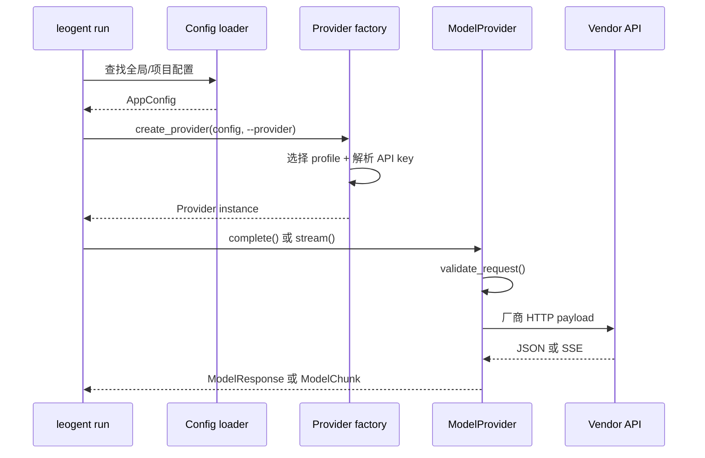

# Milestone 2 · Model Provider

Milestone 1 定义了 `ModelRequest`、`ModelResponse`、`ToolCall` 和 `Usage`。
Milestone 2 第一次把这些离线数据结构送进真实 I/O：

```text
CLI
  → 合并配置
  → Provider factory
  → ModelProvider
  → 厂商 HTTP payload
  → 厂商响应或 SSE
  → ModelResponse / ModelChunk
```

这一章只完成**一次模型请求**。模型可以返回文本或工具调用，但 Runtime 不会
执行工具，也不会继续下一轮。真正的 ReAct Loop 从 Milestone 5 开始。

本章的核心问题是：

> 如何让上层始终只看见 Leogent 的请求和响应，而把所有厂商格式、流式分片、
> 错误响应和密钥处理留在 Provider 边界内部？

## 学习目标

读完后，你应该能够：

- 沿一次 `leogent run` 请求解释 CLI、Provider factory 和 Provider 的职责；
- 解释 `Protocol`、`ModelCapabilities` 和 `ModelChunk` 分别约束什么；
- 说明上下文预算为什么在发出网络请求前校验；
- 追踪 OpenAI-compatible 消息、工具调用和 SSE 的转换过程；
- 对照 Anthropic content block 与 OpenAI delta 的流式事件差异；
- 用 Scripted Provider 和 HTTPX MockTransport 编写离线测试；
- 说明 API key 为什么只在 Provider 创建阶段解析，以及错误正文如何脱敏；
- 判断单轮 CLI 已经完成什么、还没有实现什么。

## 1. 一次请求经过哪些组件

从 `leogent run "Read README.md" --no-tui` 出发，实际调用链是：



这条链有三个明确边界：

| 边界 | 输入 | 输出 |
| --- | --- | --- |
| Provider factory | `AppConfig` 和 provider 名称 | 一个 `ModelProvider` |
| 请求转换 | `ModelRequest` | OpenAI-compatible 或 Anthropic payload |
| 响应归一化 | 厂商 JSON / stream event | `ModelResponse` / `ModelChunk` |

上层不需要知道 OpenAI 的 `choices[0].message`，也不需要知道 Anthropic 的
`content_block_delta`。它只需要消费 Milestone 1 定义的领域对象。

## 2. Provider 协议、能力声明和流式 chunk

### 2.1 用 Protocol 约束能力

Provider 基类位于
[`src/leogent/providers/base.py`](https://github.com/Navigateh/Leogent/blob/cd6f300b41fbd884595070376d3357d142b9bfa3/src/leogent/providers/base.py)。

Leogent 使用 `typing.Protocol`，而不是要求所有实现继承一个重基类：

```python
class ModelProvider(Protocol):
    @property
    def provider_id(self) -> str: ...

    @property
    def capabilities(self) -> ModelCapabilities: ...

    def complete(self, request: ModelRequest) -> ModelResponse: ...

    def stream(self, request: ModelRequest) -> Iterator[ModelChunk]: ...

    def close(self) -> None: ...
```

这样做的原因有两个：

1. 第三方 Provider 可以是普通类，不必改变继承树；
2. Runtime 只依赖行为，不依赖某个具体包路径。

Python 的 Protocol 是静态类型约束，不会在运行时自动检查所有方法。真正调用
缺失方法时仍然是普通 `AttributeError`，因此 Provider 合同测试仍然必要。

### 2.2 capabilities 描述“这个 Provider 能做什么”

`ModelCapabilities` 当前包含：

| 字段 | 用途 |
| --- | --- |
| `context_window` | 已知窗口大小；`None` 表示无法静态校验 |
| `supports_native_tools` | 是否支持结构化工具调用 |
| `supports_streaming` | 是否支持流式输出 |
| `supports_structured_output` | 是否支持结构化输出约束 |
| `supports_prompt_cache` | 是否支持提示缓存 |
| `tokenizer` | 可选 tokenizer 标识 |

当前两个 HTTP Provider 都声明：

```python
ModelCapabilities(
    context_window=config.context_window,
    supports_native_tools=True,
    supports_streaming=True,
    supports_structured_output=False,
)
```

这些值是 Provider 级声明。某些 OpenAI-compatible 服务并不真正支持 tools，
即使协议看起来相同；以后可以按 profile 覆盖，而不是在 Agent Loop 里猜服务商。

### 2.3 ModelChunk 是流式响应的最小协议

完整的非流式结果是一个 `ModelResponse`：

```python
ModelResponse(
    content="Done.",
    tool_calls=(),
    finish_reason="stop",
    usage=Usage(input_tokens=20, output_tokens=4),
)
```

流式请求拆成多个 `ModelChunk`：

```python
class ModelChunk(DomainModel):
    text_delta: str = ""
    tool_calls: tuple[ToolCall, ...] = ()
    finish_reason: str | None = None
    usage: Usage | None = None
```

文本增量可以持续到达，工具调用和 usage 通常在最后一个 chunk 出现：

```text
ModelChunk(text_delta="Read")
ModelChunk(text_delta="ing.")
ModelChunk(
    tool_calls=(ToolCall(...),),
    finish_reason="tool_calls",
    usage=Usage(...),
)
```

把“文本增量”和“最终终态”放在同一种 chunk 中，消费者可以只写一个循环。

### 2.4 与 Hermes 对照

Hermes 的
[`NormalizedResponse`](https://github.com/NousResearch/hermes-agent/blob/088f657ecf77674c7b8e2ededf4e3576d82e042c/agent/transports/types.py)
同样把跨 Provider 共享的字段放在顶层，把协议特有能力放进 `provider_data`。
它的 `Usage` 有更细的 cache 和 reasoning bucket，后来还会归一化成
`CanonicalUsage` 用于计费。

Hermes 的 `ProviderProfile` 则使用声明式字段描述端点、认证类型、环境变量、
模型能力和请求怪癖。Leogent 当前把“配置 profile”和“运行时 Provider 对象”
分开；Hermes 的生产层把更多能力放进 profile，以减少 Agent 内的条件分支。

## 3. 请求预算校验

### 3.1 校验发生在线路之前

[`validate_request()`](https://github.com/Navigateh/Leogent/blob/cd6f300b41fbd884595070376d3357d142b9bfa3/src/leogent/providers/validation.py)
在发 HTTP 请求前检查：

```python
requested_tokens = request.estimated_input_tokens + request.parameters.max_output_tokens

if requested_tokens > capabilities.context_window:
    raise ContextWindowExceeded(...)
```

预算模型采用保守的“输入估算 + 最大输出”：

```text
20,000 输入 token
  + 4,096 最大输出 token
  = 24,096
```

如果 context window 是 24,096，请求刚好允许；超过一个 token 就拒绝。

### 3.2 未知窗口不做虚假判断

当 `context_window=None` 时，`validate_request()` 直接返回。Leogent 不知道准确
窗口，就不会假装输入一定安全。

`estimated_input_tokens` 是调用方提供的估算值，不是 Provider 在这里重新计算
的精确 token 数。当前 CLI 构造的请求使用默认值 `0`，因此 M2 只严格约束显式
填写估算值的调用者。等 Milestone 6 的 ContextBuilder 和 tokenizer 到位后，
这个字段会成为真实预算决策的输入。

### 3.3 与 Hermes 对照

Hermes 不仅校验窗口，还要处理 provider-proven overflow、上下文压缩、响应
usage 校准和 failover。它的真实 prompt token 会反过来更新下一次压缩判断。

Leogent 在这里保留最小规则：一个明确的输入字段，一个准确的比较，一个专用
异常。教学版先把边界讲清楚，再在 ContextBuilder 阶段增加动态估算。

### 3.4 检查点

```bash
uv run pytest tests/unit/providers/test_base.py -q
```

把输入和输出之和改成比窗口多 1，确认抛出 `ContextWindowExceeded`；改成刚好
相等，确认请求通过。

## 4. OpenAI-compatible Provider

### 4.1 为什么先支持 OpenAI-compatible

OpenAI Chat Completions 已经成为大量本地和托管服务的公共方言：

- Ollama；
- vLLM；
- LM Studio；
- llama.cpp server；
- SGLang；
- 各种云厂商兼容网关。

支持一个 OpenAI-compatible adapter，可以让同一 Runtime 路由到许多端点，而不
需要为每个服务增加核心分支。

### 4.2 请求转换

实现位于
[`src/leogent/providers/openai_compatible.py`](https://github.com/Navigateh/Leogent/blob/cd6f300b41fbd884595070376d3357d142b9bfa3/src/leogent/providers/openai_compatible.py)。

一次 `ModelRequest` 会转换成：

```json
{
  "model": "local-model",
  "messages": [
    {"role": "system", "content": "Be concise."},
    {"role": "user", "content": "Read README.md"}
  ],
  "tools": [
    {
      "type": "function",
      "function": {
        "name": "filesystem__read_file",
        "description": "Read a file",
        "parameters": {"type": "object"}
      }
    }
  ],
  "temperature": 0.2,
  "top_p": 0.9,
  "max_tokens": 128,
  "stream": false
}
```

`ToolDefinition.input_schema` 在 Leogent 中是中立名字；到了 OpenAI wire，它变成
`function.parameters`。

assistant 历史中的 tool call 会被重新序列化：

```python
{
    "id": call.id,
    "type": "function",
    "function": {
        "name": call.name,
        "arguments": json.dumps(call.arguments, separators=(",", ":")),
    },
}
```

领域模型中的 `arguments` 是 dict，wire 格式中的 `arguments` 是 JSON 字符串。
这个转换只发生在 Provider 边界。

### 4.3 认证头按需添加

OpenAI-compatible Provider 支持无密钥本地服务：

```python
headers = {"content-type": "application/json"}
if self._api_key:
    headers["authorization"] = f"Bearer {self._api_key}"
```

本地 Ollama 不需要伪造 key；云端服务在配置提供 `api_key_env` 时使用 Bearer
认证。API key 不进入请求 payload，只进入 HTTP header。

### 4.4 非流式响应归一化

厂商返回：

```json
{
  "choices": [
    {
      "message": {
        "content": "Checking.",
        "tool_calls": [
          {
            "id": "call_1",
            "function": {
              "name": "filesystem__read_file",
              "arguments": "{\"path\": \"README.md\"}"
            }
          }
        ]
      },
      "finish_reason": "tool_calls"
    }
  ],
  "usage": {"prompt_tokens": 10, "completion_tokens": 3}
}
```

先由内部 Pydantic envelope 校验形状，再变成：

```python
ModelResponse(
    content="Checking.",
    tool_calls=(
        ToolCall(
            id="call_1",
            name="filesystem__read_file",
            arguments={"path": "README.md"},
        ),
    ),
    finish_reason="tool_calls",
    usage=Usage(input_tokens=10, output_tokens=3),
)
```

`arguments` 在这个边界被解析成 dict。如果没有 tool call ID、JSON 非法，或
arguments 不是对象，Provider 会抛出 `ProviderError`，而不是把坏数据交给上层。

当前只取 `choices[0]`。多 choice 生成不属于第一阶段单请求模型，后续需要时再
增加显式选择规则，不能默认丢弃其余 choice 而不告知调用者。

### 4.5 SSE 流式响应

流式请求使用相同 endpoint，并设置 `"stream": true`。服务通常返回：

```text
data: {"choices":[{"delta":{"content":"Read"}}]}

data: {"choices":[{"delta":{"content":"ing."}}]}

data: [DONE]
```

[`iter_sse_data()`](https://github.com/Navigateh/Leogent/blob/cd6f300b41fbd884595070376d3357d142b9bfa3/src/leogent/providers/_sse.py)
只保留有效 `data:`，跳过空行、注释和其他 SSE 字段，也跳过 `[DONE]`。

文本 delta 一到就立即 yield：

```python
if choice.delta.content:
    yield ModelChunk(text_delta=choice.delta.content)
```

工具参数则不能边到边解析。OpenAI 流式 tool call 可能长这样：

```text
chunk 1: {"index":0,"id":"call_1","function":{"name":"...","arguments":"{\"path\":"}}
chunk 2: {"index":0,"function":{"arguments":"\"README.md\"}"}}
```

Provider 按 `index` 累积 `id`、`name` 和 `arguments`：

```python
fragment = fragments.setdefault(
    tool_call.index,
    {"id": "", "name": "", "arguments": ""},
)
fragment["arguments"] += tool_call.function.arguments
```

流结束后才做一次 `json.loads()`，并且只发出一个带完整 tool calls 的最终
`ModelChunk`。这样上层不会看到半个 JSON 对象。

### 4.6 流结束 chunk

最后一个 chunk 承载：

- 完整 tool calls；
- `finish_reason`；
- usage，如果服务在流中返回。

如果服务没有给 finish reason，OpenAI-compatible Provider 使用 `"stop"`。
如果工具调用缺少 ID 或名称，则抛出 `ProviderError`。

### 4.7 与 Hermes 对照

Hermes 的 OpenAI-compatible 路径会处理更多兼容差异：不同 SDK 的 tool call
形状、推理字段回放、reasoning content、prompt cache、代理路由和非 JSON SSE。
共享响应仍然归一到 `NormalizedResponse` 和 `ToolCall`。

Hermes 还会把 Provider 错误交给
[`classify_api_error()`](https://github.com/NousResearch/hermes-agent/blob/088f657ecf77674c7b8e2ededf4e3576d82e042c/agent/error_classifier.py)，
推导重试、凭据轮换、上下文压缩或 fallback。Leogent 这里只返回带
`retryable` 和 `status_code` 的 `ProviderError`，恢复顺序留给 Runtime。

### 4.8 当前边界

Leogent 的 OpenAI adapter 故意不尝试修复所有非标准服务：

- 默认发送 `temperature` 和 `top_p`，即使某些推理模型不接受这些字段；
- 每次请求都发送 `stream`；
- 不解析 OpenAI reasoning 字段；
- 不处理原生 Responses API；
- 只解析标准 `data:` SSE，不处理任意 chunked JSON。

这些差异在真实使用中出现时，应该增加 profile 级 quirk，而不是在 Agent Loop
里判断服务商名称。

### 4.9 检查点

```bash
uv run pytest tests/unit/providers/test_openai_compatible.py -q
```

重点观察三个测试：

1. 请求 URL、Bearer header 和 payload 映射；
2. 流式文本与分片 tool arguments 的拼接；
3. HTTP 429 的 retryable 标记，以及错误信息中的 API key 脱敏。

## 5. Anthropic 原生 Provider

### 5.1 为什么不能只走兼容层

Anthropic 原生 Messages API 与 OpenAI Chat Completions 有明显结构差异：

- system prompt 是顶层 `system` 字段；
- assistant 的 tool call 是 `tool_use` content block；
- tool result 是 user 消息中的 `tool_result` block；
- 认证使用 `x-api-key`，并需要 `anthropic-version`；
- 流式事件按 message、content block 和 delta 分阶段发送。

用一个看似“兼容”的适配层可以很快跑通文本，但工具调用和历史回放容易丢结构。
Milestone 2 因此提供原生 Provider。

### 5.2 请求转换

实现位于
[`src/leogent/providers/anthropic.py`](https://github.com/Navigateh/Leogent/blob/cd6f300b41fbd884595070376d3357d142b9bfa3/src/leogent/providers/anthropic.py)。

转换关系如下：

| Leogent | Anthropic |
| --- | --- |
| `system` Message | payload 顶层 `system` |
| user Message | `{"role":"user","content":"..."}` |
| assistant tool call | `tool_use` block |
| tool Message | user 消息中的 `tool_result` block |
| `ToolDefinition.input_schema` | tool 的 `input_schema` |
| `max_output_tokens` | `max_tokens` |
| `stop` | `stop_sequences` |

system 消息不会留在 `messages` 数组中：

```python
system_messages = [
    message.content
    for message in request.messages
    if message.role is MessageRole.SYSTEM and message.content
]
```

多个 system 片段用两个换行连接。

### 5.3 只发送显式设置的可选参数

OpenAI-compatible adapter 会始终发送温度和 top-p。Anthropic adapter 则使用
Pydantic 的 `model_fields_set`：

```python
if "temperature" in request.parameters.model_fields_set:
    payload["temperature"] = request.parameters.temperature
if "top_p" in request.parameters.model_fields_set:
    payload["top_p"] = request.parameters.top_p
```

这避免调用者没有设置参数时，默认值意外覆盖服务端行为。它也是一个有用原则：
当默认值是实现语言的选择、而厂商有自己默认值时，“未设置”和“设置为默认值”
不是同一件事。

### 5.4 非流式响应

Anthropic 返回的 `content` 是 block 数组。Provider 将同一响应中的 text block
拼接成一个 `content` 字符串，将 `tool_use` block 转为 `ToolCall`：

```python
content = [
    {"type": "text", "text": "Reading."},
    {
        "type": "tool_use",
        "id": "tool_1",
        "name": "filesystem__read_file",
        "input": {"path": "README.md"},
    },
]
```

`stop_reason` 直接作为 `finish_reason`，usage 映射为输入和输出 token。

如果 `tool_use` 缺少 ID 或名称，Provider 拒绝返回不完整调用。

### 5.5 Anthropic 流式事件

Anthropic 的事件顺序与 OpenAI `delta` 不同：

```text
message_start
  → content_block_start(text)
  → content_block_delta(text_delta)...
  → content_block_start(tool_use)
  → content_block_delta(input_json_delta)...
  → message_delta(stop_reason, output usage)
  → message_stop
```

Leogent 的处理：

| 事件 | 动作 |
| --- | --- |
| `message_start` | 读取 input tokens |
| `content_block_start` 且类型为 `tool_use` | 按 index 建立工具参数缓冲 |
| `content_block_delta` / `text_delta` | 立即 yield 文本 chunk |
| `content_block_delta` / `input_json_delta` | 追加 partial JSON |
| `message_delta` | 记录 stop reason 和 output tokens |
| 流结束 | 解析完整工具参数并 yield 最终 chunk |

实际流中还有许多 `content_block_stop` 和 `message_stop` 事件。当前 Provider
不依赖它们，因为最终状态可以从 delta 和流结束推导；未知事件会被 Pydantic
接受，但不会触发额外动作。

### 5.6 与 Hermes 对照

Hermes 的
[`anthropic_adapter.py`](https://github.com/NousResearch/hermes-agent/blob/088f657ecf77674c7b8e2ededf4e3576d82e042c/agent/anthropic_adapter.py)
处理了更多内容类型：thinking block、signature 回放、cache usage、长上下文
beta、图片 block、工具增量以及不同 Claude 模型的能力差异。

两者共享的原则相同：

- 原生消息结构在 adapter 中转换；
- tool call 与 tool result 必须保持 ID 和顺序；
- 流式文本可以立即输出，结构化的工具参数必须等完整 JSON；
- Provider 特有能力不能泄漏成 Runtime 条件分支。

### 5.7 检查点

```bash
uv run pytest tests/unit/providers/test_anthropic.py -q
```

观察 system 提取、`tool_result` 映射、`x-api-key` header，以及
`input_json_delta` 如何合并成一个参数字典。

## 6. Scripted Provider 与离线测试

### 6.1 不依赖网络的 Provider

[`ScriptedProvider`](https://github.com/Navigateh/Leogent/blob/cd6f300b41fbd884595070376d3357d142b9bfa3/src/leogent/providers/mock.py)
按顺序返回预设响应：

```python
provider = ScriptedProvider(
    (
        ModelResponse(content="first"),
        ModelResponse(content="second"),
    )
)
```

它还记录收到的每个 `ModelRequest`：

```python
provider.requests
```

这让测试可以同时验证：

- CLI 构造的请求内容；
- Provider 返回后 CLI 如何渲染；
- Runtime 在固定输入下是否走相同轨迹。

响应脚本耗尽会抛出 `ProviderError`。`responses` 还允许放一个异常对象，用来
模拟上游失败。

`stream()` 会把一个完整 `ModelResponse` 拆成文本 chunk 和最终 chunk。它适合
验证消费者逻辑，不等价于模拟真实网络的逐帧时序。

### 6.2 HTTPX MockTransport

HTTP Provider 测试不需要启动服务器，而是把
[`httpx.MockTransport`](https://www.python-httpx.org/advanced/transports/)
注入 Provider：

```python
client = httpx.Client(transport=httpx.MockTransport(handler))
provider = OpenAICompatibleProvider(config, client=client)
```

`handler` 收到真实构造的 `httpx.Request`，可以断言 URL、header、body，再返回
构造好的 `httpx.Response`。

这比 patch `client.post` 更接近真实执行路径：

- URL 拼接会真实发生；
- header 会真正进入请求对象；
- SSE 会经过响应对象的 `iter_lines()`；
- 错误状态和响应文本会真实进入错误归一化。

### 6.3 与 Hermes 对照

Hermes 同样依赖 HTTPX mock transport 和 scripted provider 做离线验证，但还会
覆盖真实 SDK 客户端、重试状态、credential pool、fallback 和网关流式消费者。
生产测试更强调“补丁打在运行时真正读取的 seam 上”，否则测试可能通过，生产
路径却没有变化。

Leogent 当前的注入点是 Provider 构造函数，较小也更直观。后续增加重试和
fallback 时，应继续通过依赖注入验证完整调用链。

### 6.4 检查点

```bash
uv run pytest tests/unit/providers/test_mock.py -q
```

再运行 HTTP Provider 测试，确认整个测试集默认不访问网络：

```bash
uv run pytest tests/unit/providers -q
```

## 7. Provider factory 与密钥解析

### 7.1 根据配置选择实现

[`create_provider()`](https://github.com/Navigateh/Leogent/blob/cd6f300b41fbd884595070376d3357d142b9bfa3/src/leogent/providers/factory.py)
做三件事：

1. 使用显式 `provider_name`，否则使用 `config.default_provider`；
2. 从合并后的配置取得 provider profile；
3. 通过 `resolve_api_key()` 解析需要认证的 profile。

选择规则：

```text
CLI --provider
    → config.default_provider
    → 精确匹配 providers[name]
    → 按 discriminator type 创建具体 Provider
```

未找到 profile 时抛 `ConfigurationError`，不会悄悄回退到另一个 Provider。

### 7.2 只在 factory 阶段读取环境变量

配置加载和配置校验不读取 secret。只有创建 Provider 时：

```python
api_key = resolve_api_key(profile, environment)
```

会按 `api_key_env` 查找环境：

```bash
export ANTHROPIC_API_KEY="..."
uv run leogent run "hello" --provider cloud --no-tui
```

OpenAI-compatible Provider 允许 `api_key=None`，因为本地 Ollama、LM Studio 等
服务可能不需要认证。Anthropic 必须有 key；缺失时 factory 明确报告环境变量名。

### 7.3 Transformers 在 Milestone 10

配置模型已经支持 `TransformersProviderConfig`，所以用户可以看到并校验本地
模型路径配置。但 Milestone 2 尚未加载 Torch/Transformers。

如果此时选择它，factory 会抛：

```text
Transformers providers are implemented in Milestone 10;
use an OpenAI-compatible local server for now
```

提前解析配置、延迟实现执行器，可以让后续接口稳定，同时不把所有重型依赖塞进
第二阶段。

### 7.4 与 Hermes 对照

Hermes 的 Provider 选择位于
[`runtime_provider.py`](https://github.com/NousResearch/hermes-agent/blob/088f657ecf77674c7b8e2ededf4e3576d82e042c/hermes_cli/runtime_provider.py)
及插件 provider registry。除了 default 和显式选择外，还会处理：

- credential pool；
- profile scoped secret；
- OAuth refresh；
- 自定义 endpoint；
- 模型别名；
- fallback chain；
- provider-specific api mode。

Leogent 当前只实现确定性最高的最小 factory。关键是失败必须显式：未知
provider、缺失 Anthropic key、未实现 Transformers 都不能被当作成功路径。

### 7.5 检查点

```bash
uv run pytest tests/unit/providers/test_factory.py -q
```

测试不传真实 key，只传环境 mapping；这保证 factory 合同与主机环境隔离。

## 8. 单轮 CLI

### 8.1 run_once 的职责

[`run_once()`](https://github.com/Navigateh/Leogent/blob/cd6f300b41fbd884595070376d3357d142b9bfa3/src/leogent/cli/run.py)
只负责一次请求：

```python
def run_once(provider, prompt, *, stream=False):
    if not prompt.strip():
        raise typer.BadParameter("prompt must not be empty")
    request = ModelRequest(
        messages=(Message(role=MessageRole.USER, content=prompt),),
    )
    ...
```

当前不注入 system prompt、工具定义、历史消息或上下文计划。这些能力分别在后续
ContextBuilder、MCP 和 Agent Loop 中加入。

### 8.2 流式与非流式

流式分支只有在 Provider 声明支持时才执行：

```python
if stream and provider.capabilities.supports_streaming:
    for chunk in provider.stream(request):
        if chunk.text_delta:
            typer.echo(chunk.text_delta, nl=False)
```

非流式分支调用：

```python
response = provider.complete(request)
```

两个分支最终都返回文本，并把工具调用汇总给终端提示。它们没有执行工具。

### 8.3 工具调用提示

如果模型返回：

```python
ModelResponse(
    tool_calls=(ToolCall(id="call_1", name="filesystem__read_file", arguments={}),),
)
```

CLI 会向 stderr 输出：

```text
Model requested tool calls (filesystem__read_file);
tool execution starts in Milestone 4.
```

这既避免模型意图被静默忽略，也明确告诉读者：单轮 Provider 已经能识别工具
调用，但还没有执行器。

### 8.4 配置和命令示例

本地 OpenAI-compatible：

```json
{
  "default_provider": "local",
  "providers": {
    "local": {
      "type": "openai-compatible",
      "base_url": "http://localhost:11434/v1",
      "model": "qwen2.5-coder:7b"
    }
  }
}
```

```bash
uv run leogent run "Explain an agent loop" --no-tui
uv run leogent run "Explain an agent loop" --no-tui --no-stream
```

Anthropic：

```json
{
  "default_provider": "cloud",
  "providers": {
    "cloud": {
      "type": "anthropic",
      "model": "your-model",
      "api_key_env": "ANTHROPIC_API_KEY"
    }
  }
}
```

示例配置只保存环境变量名，不保存实际 key。

### 8.5 与 Hermes 对照

Hermes 的 CLI 最终进入完整 turn loop，还要处理工具执行、会话持久化、上下文
压缩、回调、取消和多平台输出。单轮 `run_once` 是把这条大链路拆开来观察的最
小入口。

## 9. 错误、重试标记和密钥脱敏

### 9.1 传输错误

`httpx.HTTPError` 被转换成：

```python
ProviderError("... request failed", retryable=True)
```

连接失败、读超时和暂时性网络错误通常值得重试，但 Milestone 2 没有自动 retry
循环；它只提供分类，真正的重试属于 Runtime。

### 9.2 HTTP 状态错误

[`src/leogent/providers/_http.py`](https://github.com/Navigateh/Leogent/blob/cd6f300b41fbd884595070376d3357d142b9bfa3/src/leogent/providers/_http.py)
定义：

```python
def retryable_status(status_code):
    return status_code in {408, 409, 425, 429} or status_code >= 500
```

错误对象保留：

- provider 名称；
- HTTP status；
- 最多 1000 字符的响应正文；
- `retryable`；
- `status_code`。

### 9.3 响应正文脱敏

错误正文在进入异常前执行：

```python
body = redact(response.text[:1000].strip(), secret)
```

如果上游错误消息回显 API key，Provider 会替换成 `[redacted]`。测试专门构造
429 响应，并在正文中包含请求 key，验证异常字符串不泄漏 secret。

这是边界级保护，不是通用日志脱敏系统。其他敏感业务数据仍需要上层日志策略，
不能把“key 已被替换”误认为所有错误正文都安全。

### 9.4 与 Hermes 对照

Hermes 的 `ClassifiedError` 同时包含 `reason`、`retryable`、`should_compress`、
`should_rotate_credential` 和 `should_fallback`。它还会按 provider profile、
HTTP 状态、结构化错误码和消息模式分阶段判断。

Leogent 当前只保留 retryable 与 status，这是有意的延迟：没有 retry loop 时，
过早加入五类恢复策略只会产生未使用字段。

## 10. 用 ScriptedProvider 跑通一次请求

下面的例子不访问网络，完整走一遍从 `ModelRequest` 到 `ModelResponse` 的边界：

```python
from leogent.cli.run import run_once
from leogent.domain import ModelResponse, ToolCall, Usage
from leogent.providers.base import ModelCapabilities
from leogent.providers.mock import ScriptedProvider


provider = ScriptedProvider(
    (
        ModelResponse(
            content="Checking the readme.",
            tool_calls=(
                ToolCall(
                    id="call_1",
                    name="filesystem__read_file",
                    arguments={"path": "README.md"},
                ),
            ),
            finish_reason="tool_calls",
            usage=Usage(input_tokens=12, output_tokens=5),
        ),
    ),
    capabilities=ModelCapabilities(context_window=8192),
)

text = run_once(provider, "Explain this repository", stream=False)

assert text == "Checking the readme."
assert provider.requests[0].messages[0].content == "Explain this repository"
assert provider.requests[0].messages[0].role == "user"
```

这段代码还会在 stdout 打印模型文本，在 stderr 打印工具调用提示。它不是完整
CLI 测试，但展示了单轮请求的三个事实：

1. CLI 构造的是标准 `ModelRequest`；
2. Provider 返回标准 `ModelResponse`；
3. tool call 被识别但没有被执行。

## 11. 测试地图与运行方式

### 11.1 Provider 测试

| 文件 | 验证内容 |
| --- | --- |
| `test_base.py` | Protocol 相关模型、chunk 回环、上下文预算 |
| `test_openai_compatible.py` | 请求映射、响应归一化、SSE、错误脱敏 |
| `test_anthropic.py` | system/tool block 映射、原生流事件 |
| `test_mock.py` | 响应顺序、请求录制、脚本耗尽 |
| `test_factory.py` | Provider 选择、key 缺失、Transformers 延迟 |
| `test_run_cli.py` | 流式/非流式输出、空 prompt、显式 provider |

### 11.2 只跑本章

```bash
uv run pytest tests/unit/providers tests/e2e/test_run_cli.py -q
```

### 11.3 完整离线质量门

```bash
uv run ruff format --check .
uv run ruff check .
uv run pyright
uv run pytest -q
uv run python -m build
```

### 11.4 真实 Provider 验收

先创建真实配置并导出所需环境变量，再执行：

```bash
uv run pytest -m live tests/integration/test_live_provider.py -v
uv run leogent run "Reply with exactly: Leogent ready" --no-tui
```

如果没有配置或缺少密钥，live test 会 skip；这不能被当作真实 Provider 已验收。

## 12. 修改实验

### 实验 A：让 OpenAI 请求只在设置时发送温度

参照 Anthropic adapter 的 `model_fields_set` 逻辑，修改 OpenAI payload，并先写
两个测试：

- 未设置 temperature 时 payload 不包含该字段；
- 显式设置为 0.0 时仍发送 `temperature: 0.0`。

### 实验 B：增加 SSE keepalive 测试

在流响应中加入注释行、空 data 和 `[DONE]`，确认 `iter_sse_data()` 忽略它们，
且文本与最终 tool calls 不受影响。

### 实验 C：模拟 HTTP 500

让 MockTransport 返回 500，检查 `ProviderError.retryable`、`status_code` 和
错误正文。再返回 401，确认 500 被标记为 retryable，而 401 没有；然后思考
Runtime 未来应该如何把 401 交给凭据轮换或重新登录流程。

### 实验 D：增加新的 Provider

创建一个只返回固定文本的 Provider，满足 `ModelProvider` 协议，并使用
`run_once()` 调用。不要修改 CLI；如果 CLI 需要改动，说明 Provider 边界没有
抽象完整。

### 实验 E：验证 Anthropic 参数“未设置”

删除请求中的 `temperature` 和 `top_p`，确认 payload 不包含两个字段；显式设置
温度为 0.0，确认字段存在。这个实验解释“默认值”和“显式值”的区别。

## 13. 本章结论

Milestone 2 完成了从领域对象到真实模型的第一次往返：

- `ModelProvider` 定义统一行为；
- `ModelCapabilities` 声明窗口、工具、流式和缓存能力；
- `validate_request()` 在 I/O 前检查已知预算；
- OpenAI-compatible adapter 完成消息、工具、usage、SSE 和错误归一化；
- Anthropic adapter 完成 system、tool block、原生流事件和 usage 映射；
- `ScriptedProvider` 与 HTTPX MockTransport 让默认测试完全离线；
- factory 根据配置选择实现，并只在创建 Provider 时解析 secret；
- `run_once()` 提供最小单轮 CLI 入口；
- 错误对象带 retryable 分类，HTTP 错误正文会移除已使用的 API key。

下一章进入 Session 与事件。模型响应将第一次被持久化为可恢复的事实，而不是
只作为当前进程中的返回值。
