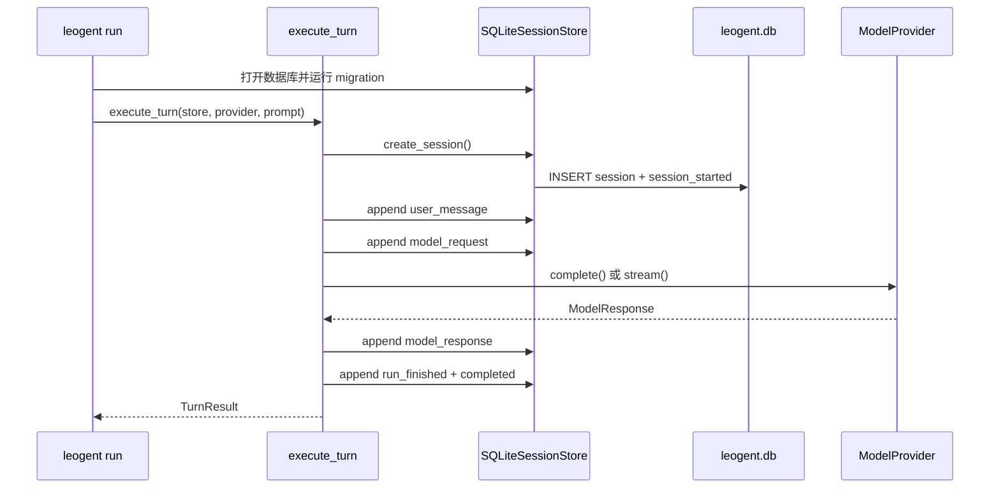

# Milestone 3 · Session 与事件

Milestone 2 已经能让一次 Prompt 经过 Provider，变成标准的 `ModelResponse`。
但只要进程退出，这次交互就消失了。CLI 无法回答“刚才发生了什么”，下一次
启动也无法继续同一段对话。

Milestone 3 给单轮执行加上持久化：

```text
leogent run
  → 创建或恢复 Session
  → 追加 USER_MESSAGE
  → 追加 MODEL_REQUEST
  → 调用 Provider
  → 追加 MODEL_RESPONSE
  → 追加 RUN_FINISHED
  → SQLite 中留下可查询、可恢复、可 fork 的事实序列
```

这一章仍然不会执行工具，也不会运行 ReAct Loop。`resume` 可以把多次单轮请求
接在同一个 Session 后面，但工具执行从 Milestone 4 才开始，自主循环从
Milestone 5 才开始。

本章的核心问题是：

> 如何让 SQLite 中的历史记录成为唯一事实来源，使进程崩溃后仍能恢复 Session，
> 并且让 RunState、对话历史和 fork 都由同一组事件推导出来？

## 学习目标

读完后，你应该能够：

- 解释 Session、Event 和 RunState 为什么是三个不同层次；
- 说明 `SessionStore` Protocol 如何隔离 CLI 与 SQLite 实现；
- 追踪一次 `execute_turn()` 产生的完整事件序列；
- 解释 schema migration、WAL 和 append-only trigger 的作用；
- 理解连续 sequence 为什么必须在写事务内分配；
- 从事件 fold 出 step、usage、context token 和终止原因；
- 说明 resume 如何从历史事件重建下一次 `ModelRequest`；
- 解释 fork 为什么复制事件前缀并生成新事件 ID；
- 使用 `run`、`resume` 和 `sessions` 子命令观察持久化结果；
- 对照 Hermes 的 SessionDB、SessionAuthority 和 lineage，判断教学版省略了什么。

## 1. 从一次运行看持久化边界

从新 Session 开始，调用链是：



这里有两个角色不能混在一起：

| 角色 | 职责 |
| --- | --- |
| Session Store | 保存 Session、事件顺序和事务边界 |
| Turn Runner | 决定一轮运行产生哪些事件，并调用 Provider |

CLI 只负责配置、创建对象、打印结果。它不直接拼 SQL，也不直接决定 RunState。

恢复已有 Session 时，调用链多了一步历史读取：

```text
load Session
  → get_events()
  → 只提取 user_message 和 model_response
  → 构造历史 Message
  → 追加新的 user_message
  → 发起下一轮 ModelRequest
```

历史消息不是单独保存的“conversation state”。它们同样来自事件日志。

## 2. Event-Sourced Session 的三个层次

### 2.1 Session 描述身份和生命周期

核心模型位于
[`src/leogent/domain/event.py`](https://github.com/Navigateh/Leogent/blob/803bf41b0f05bc95b74fecf41b36268cd43a64b4/src/leogent/domain/event.py)。

```python
class Session(DomainModel):
    id: UUID = Field(default_factory=uuid4)
    status: SessionStatus = SessionStatus.ACTIVE
    created_at: UtcDateTime = Field(default_factory=utc_now)
    updated_at: UtcDateTime = Field(default_factory=utc_now)
    parent_session_id: UUID | None = None
    fork_event_sequence: int | None = Field(default=None, ge=1)
```

它回答的是“这是哪段会话”：

- UUID 用于 CLI 恢复和 fork；
- `ACTIVE`、`COMPLETED`、`FAILED`、`CANCELLED` 描述生命周期；
- `created_at` 和 `updated_at` 支持最近会话排序；
- `parent_session_id` 与 `fork_event_sequence` 记录 fork 来源。

Pydantic validator 额外保证：

- `updated_at` 不能早于 `created_at`；
- fork 来源和 fork sequence 必须同时存在；
- Session 不能把自己当作父 Session。

这些规则防止数据库中出现结构上无法解释的生命周期记录。

### 2.2 Event 描述不可变事实

```python
class Event(DomainModel):
    event_id: UUID = Field(default_factory=uuid4)
    session_id: UUID
    sequence: int = Field(ge=1)
    event_type: EventType
    occurred_at: UtcDateTime = Field(default_factory=utc_now)
    payload: dict[str, JsonValue] = Field(default_factory=dict)
```

Event 的身份由两部分组成：

1. 全局唯一的 `event_id`；
2. 单个 Session 内连续递增的 `sequence`。

`event_id` 适合跨表引用，`sequence` 适合表达顺序和范围。比如 fork 时复制
`1..2`，比“复制前两条”更明确，因为顺序本身就是数据契约。

`payload` 只允许 JSON-compatible value。文本、工具调用、usage、错误信息和终止
原因都可以放进去，但不能把任意 Python 对象直接塞进 SQLite。

### 2.3 RunState 是 fold 出来的摘要

```python
class RunState(DomainModel):
    session_id: UUID
    current_step: int = Field(default=0, ge=0)
    context_tokens: int = Field(default=0, ge=0)
    usage: Usage = Field(default_factory=Usage)
    termination_reason: TerminationReason | None = None
```

RunState 可以由事件重新计算：

| 事件 | 对 RunState 的影响 |
| --- | --- |
| `MODEL_REQUEST` | `current_step += 1` |
| `MODEL_RESPONSE` | 累加 input/output usage |
| `CONTEXT_COMPACTED` | 更新当前 context token 数 |
| `RUN_FINISHED` | 写入终止原因 |
| `RUN_FAILED` | 终止原因设为 `ERROR` |

如果把 RunState 再保存成一份可变快照，进程可能遇到“事件已经提交，但快照没有
更新”的半完成状态。这里选择每次从事件重建，牺牲一点计算，换取单一事实来源。

`Session.status` 和 `RunState.termination_reason` 也不是重复字段。前者是持久化
生命周期，后者是从运行事件推导出的结果。一个 Session 被 resume 后会重新变成
`ACTIVE`，而历史中上一轮的 `RUN_FINISHED` 事件不会消失。

### 2.4 SessionStore 是小接口

[`src/leogent/sessions/base.py`](https://github.com/Navigateh/Leogent/blob/803bf41b0f05bc95b74fecf41b36268cd43a64b4/src/leogent/sessions/base.py)
定义 Runner 和 CLI 需要的操作：

```python
class SessionStore(Protocol):
    def create_session(self) -> Session: ...

    def append_event(
        self,
        session_id: UUID | str,
        event_type: EventType,
        payload: dict[str, JsonValue] | None = None,
    ) -> Event: ...

    def get_events(
        self,
        session_id: UUID | str,
        *,
        start_sequence: int = 1,
        end_sequence: int | None = None,
    ) -> tuple[Event, ...]: ...

    def rebuild_run_state(self, session_id: UUID | str) -> RunState: ...

    def fork_session(self, session_id: UUID | str, at_sequence: int) -> Session: ...
```

实际 Protocol 还包含查询 Session、更新状态和关闭连接等方法。这里展示的是
Session 语义的核心。

使用 Protocol 后，Runner 只依赖行为。以后可以增加 JSONL store、远程 store 或
测试内存 store，而不需要改 `execute_turn()`。

### 2.5 与 Hermes 对照

Hermes 的
[`SessionDB`](https://github.com/NousResearch/hermes-agent/blob/088f657ecf77674c7b8e2ededf4e3576d82e042c/hermes_state.py)
是一个 façade，具体职责分布到 `hermes_state_*.py` siblings。它保存的不只是
对话，还包括来源平台、模型配置、token 统计、工作目录、标题、FTS 索引、压缩
lineage 和恢复状态。

Hermes 还定义了
[`SessionAuthority`](https://github.com/NousResearch/hermes-agent/blob/088f657ecf77674c7b8e2ededf4e3576d82e042c/gateway/session_contract.py)
协议，把附件、提交、排队、取消、执行 generation 和 replay 等操作封装在统一边界
之后。它的目标是让 CLI、Gateway、Desktop 和 TUI 共享同一套 Session authority。

Leogent 当前只保留持久化所需的最小合同：创建、追加、读取、重建和 fork。接口
更小，也更容易在教程中完整追踪。

## 3. SQLite 数据文件、Schema 和迁移

### 3.1 默认数据库位置

[`default_database_path()`](https://github.com/Navigateh/Leogent/blob/803bf41b0f05bc95b74fecf41b36268cd43a64b4/src/leogent/sessions/sqlite.py)
返回：

```python
data_directory(environ) / "leogent.db"
```

因此设置：

```bash
export LEOGENT_HOME="$HOME/.local/share/leogent-demo"
```

后，Session 数据库会位于：

```text
$LEOGENT_HOME/leogent.db
```

测试必须使用临时 `LEOGENT_HOME`，不能写开发者的真实数据目录。

### 3.2 为什么选择 SQLite

SQLite 适合当前规模：

- 单文件，便于观察和备份；
- 支持事务、唯一约束和外键；
- Python 标准库直接支持；
- WAL 模式允许读和写在常见 CLI 场景中并发；
- 后续可以继续增加索引和迁移，而不用引入独立数据库服务。

`SQLiteSessionStore` 为文件数据库开启：

```python
PRAGMA foreign_keys = ON
PRAGMA journal_mode = WAL
```

内存数据库 `:memory:` 不设置 WAL，因为 WAL 针对文件持久化场景。

### 3.3 三张初始表

[`schema.py`](https://github.com/Navigateh/Leogent/blob/803bf41b0f05bc95b74fecf41b36268cd43a64b4/src/leogent/sessions/schema.py)
当前 schema version 是 `2`。

Migration 1 创建：

| 表 | 作用 |
| --- | --- |
| `schema_versions` | 记录已执行的 migration |
| `sessions` | Session 身份、状态、时间和 fork 来源 |
| `events` | 不可变事件及其 Session 内 sequence |

`events` 上的关键约束是：

```sql
UNIQUE (session_id, sequence)
CHECK (sequence > 0)
```

它们保证同一 Session 中不可能出现两个 sequence 2。

Migration 2 增加：

- `sessions(updated_at DESC)` 索引；
- `events(session_id, sequence)` 查询索引；
- 拒绝 `UPDATE events` 的 trigger；
- 拒绝 `DELETE events` 的 trigger。

append-only 不只依赖 Python 调用方自觉。即使另一个进程直接用 `sqlite3` 打开
数据库，数据库自己也会拒绝改写历史事件。

### 3.4 每个 migration 单独提交

迁移逻辑逐条执行：

```python
for version, statements in MIGRATIONS:
    if version <= current_version:
        continue
    connection.execute("BEGIN IMMEDIATE")
    try:
        for statement in statements:
            connection.execute(statement)
        connection.execute(
            "INSERT INTO schema_versions(version, applied_at) VALUES (?, ?)",
            (version, datetime.now(tz=UTC).isoformat()),
        )
        connection.execute("COMMIT")
    except Exception:
        connection.execute("ROLLBACK")
        raise
```

DDL 和版本记录在同一个事务里。如果第二个 statement 失败，不能留下“表改了一半，
但版本没记录”的数据库。

重复打开同一数据库是幂等的：当前版本已经是 2 时，后续 migration 全部跳过。

### 3.5 与 Hermes 对照

Hermes 的 schema 定义在
[`hermes_state_common.py`](https://github.com/NousResearch/hermes-agent/blob/088f657ecf77674c7b8e2ededf4e3576d82e042c/hermes_state_common.py)。
它使用 `sessions` 和 `messages` 作为主要持久化表，并加入 active/compacted
消息、FTS、routing、admission、worker execution、compression lock 等大量生产级
结构。

两者的共同点不是表名相同，而是都把持久化知识限制在 store 层：

- 上层不直接操作数据库行；
- schema 变更通过显式 migration；
- 状态更新需要事务；
- 测试必须隔离真实用户数据库。

## 4. 创建 Session 和追加事件

### 4.1 `create_session()` 同时创建两个事实

一个新 Session 并不是只插入 `sessions` 一行。它还要产生第一个事件：

```text
sequence 1 = session_started
```

实现使用一个事务：

```python
with self._transaction():
    self._insert_session(session)
    self._insert_event(
        session_id=session.id,
        event_type=EventType.SESSION_STARTED,
        payload={"status": SessionStatus.ACTIVE.value},
    )
```

这样不会出现“Session 已存在，却没有任何开始事件”的中间状态。

### 4.2 sequence 在写事务内计算

追加事件时先计算：

```sql
SELECT COALESCE(MAX(sequence), 0) + 1
FROM events
WHERE session_id = ?
```

然后执行 INSERT，并在同一个 `BEGIN IMMEDIATE` 事务中更新 Session 时间或状态。

为什么不能先在事务外读 `MAX(sequence)`？两个进程可能同时读到相同结果，然后
其中一个 INSERT 因唯一约束失败。`BEGIN IMMEDIATE` 提前取得写锁，使“读取下一
序号 + 写入事件 + 更新 Session”成为一个串行步骤。

当前设计的目标是单 Session 内连续、无重复 sequence：

```text
1  session_started
2  user_message
3  model_request
4  model_response
5  run_finished
```

### 4.3 Event 和状态在同一事务中提交

`append_event()` 支持传入 `session_status`。例如完成运行：

```python
store.append_event(
    session.id,
    EventType.RUN_FINISHED,
    {"reason": "completed"},
    session_status=SessionStatus.COMPLETED,
)
```

事件插入和 Session 状态更新共享同一个事务。不会出现事件显示“完成”，但列表
中 Session 仍是 `ACTIVE` 的分裂状态。

失败同理：

```python
store.append_event(
    session.id,
    EventType.RUN_FAILED,
    {"error_code": "provider", "message": "model unavailable"},
    session_status=SessionStatus.FAILED,
)
```

### 4.4 DuplicateEvent 与 SessionNotFound

`event_id` 是主键。如果调用方显式传入已经存在的 event ID，`append_event()` 将
`sqlite3.IntegrityError` 转成 `DuplicateEvent`。

不存在或格式非法的 Session ID 则抛 `SessionNotFound`。CLI 不需要猜测“数据库
没有结果”还是“输入根本不是一个 UUID”，Store 会给出明确错误。

### 4.5 查询和列表

`get_events()` 支持序列范围：

```python
events = store.get_events(
    session.id,
    start_sequence=2,
    end_sequence=4,
)
```

结果是 `2, 3, 4`，按 sequence 升序。fork 直接复用这个能力读取事件前缀。

`list_sessions()` 按 `updated_at DESC` 排序，适合 CLI 显示最近会话。`limit`
必须为正数，防止无界查询悄悄通过。

### 4.6 WAL 与测试隔离

WAL 让常见读操作不必与单个写事务互相阻塞。但 WAL 不是“无限并发写”：SQLite
仍只有一个 writer。`BEGIN IMMEDIATE` 让写事务显式排队，这比在 Python 中维护
一个进程内锁更可靠，因为锁属于数据库文件本身。

E2E 测试统一设置：

```python
monkeypatch.setenv("LEOGENT_HOME", str(tmp_path))
```

这样 `default_database_path()` 指向临时目录，不会污染真实 Session。

## 5. 从 Event fold 出 RunState

### 5.1 step 是模型请求数

`rebuild_run_state()` 每遇到一个 `MODEL_REQUEST` 就递增 `current_step`。

它不使用用户消息数，也不使用 Provider 返回次数。这样定义很明确：

```text
current_step = 已发起过多少次模型请求
```

失败的 Provider 调用在抛出前已经有 `MODEL_REQUEST` 事件，因此 step 会包含这次
尝试。失败事实由 `RUN_FAILED` 表示，不由 step 表示。

### 5.2 usage 累加

一个 Session 可能有多次 resume。每次 `MODEL_RESPONSE` payload 中的 usage 都会
累加：

```python
input_tokens += int(usage_data.get("input_tokens", 0))
output_tokens += int(usage_data.get("output_tokens", 0))
```

返回的 `Usage.total_tokens` 仍然是派生属性，不再存储第三个数。

持久化数据不可信时，例如：

```json
{"usage": {"input_tokens": "many"}}
```

fold 会抛 `SessionError`，而不是把字符串悄悄转换成 0。损坏的数据必须显式失败，
否则统计会长期偏离真实值。

### 5.3 context token 取最新压缩事实

`CONTEXT_COMPACTED` 事件可以包含 `estimated_tokens`，也兼容 `context_tokens`。
后来事件覆盖前面事件：

```python
context_tokens = int(value)
```

它表示当前上下文窗口的估计大小，不是累计处理过的 token。累计模型成本由 usage
表示，二者语义不同。

Milestone 3 还没有真正生成压缩事件；该事件类型和 fold 规则先为 Milestone 6
建立稳定接口。

### 5.4 终止原因

`RUN_FINISHED` 的 payload 可以给出：

- `completed`；
- `max_steps`；
- `token_budget`；
- `cancelled`。

`RUN_FAILED` 直接映射成 `error`。

如果 Session 只有开始事件和用户消息，RunState 的 `termination_reason` 保持
`None`。这正是崩溃恢复需要观察的“未完成运行”。

### 5.5 与 Hermes 对照

Hermes 同时保存消息、inline 统计和生产级 usage bucket，并在压缩时建立新的
Session lineage。它还要处理 active turn lease、并发压缩锁、WAL 损坏分类和
跨进程恢复。

Leogent 选择纯事件 fold，是因为它能直接回答教学问题：

```text
给定同一组事件，就能得到同一份 RunState。
```

等上下文和工具事件变复杂后，可以优化缓存，但事件日志仍应保留为审计与恢复的
权威来源。

## 6. `execute_turn()` 如何记录一轮

### 6.1 新 Session 与恢复 Session

[`execute_turn()`](https://github.com/Navigateh/Leogent/blob/803bf41b0f05bc95b74fecf41b36268cd43a64b4/src/leogent/sessions/runner.py)
根据是否传入 `session_id` 分两条路径：

```python
if session_id is None:
    session = store.create_session()
    history: tuple[Message, ...] = ()
else:
    session = store.get_session(session_id)
    history = _history_messages(store.get_events(session.id))
    if session.status is not SessionStatus.ACTIVE:
        session = store.update_session_status(session.id, SessionStatus.ACTIVE)
```

新 Session 从 `session_started` 开始。恢复已有 Session 时，历史来自事件，随后
生命周期重新标为 `ACTIVE`。

### 6.2 成功运行的事件顺序

成功单轮固定产生：

```text
1  session_started   （只有新 Session）
2  user_message
3  model_request
4  model_response
5  run_finished
```

对应代码分阶段提交：

```python
store.append_event(session.id, EventType.USER_MESSAGE, {"content": prompt})
store.append_event(
    session.id,
    EventType.MODEL_REQUEST,
    request.model_dump(mode="json"),
)
...
store.append_event(
    session.id,
    EventType.MODEL_RESPONSE,
    response.model_dump(mode="json"),
)
store.append_event(
    session.id,
    EventType.RUN_FINISHED,
    {"reason": TerminationReason.COMPLETED.value},
    session_status=SessionStatus.COMPLETED,
)
```

这里不是把整轮放进一个跨网络请求的大事务。那样会长时间锁住 SQLite，也无法在
Provider 很慢时保存用户输入。

相反，每条事实在自己的短事务中提交：

- 用户消息先落盘；
- 模型请求参数在发网络请求前落盘；
- 归一化响应在返回后落盘；
- 最后一次事件同时写入完成原因和 Session 状态。

### 6.3 `MODEL_REQUEST` 保存的是什么

保存的是完整领域请求的 JSON：

```json
{
  "messages": [
    {"role": "user", "content": "Say hello"}
  ],
  "tools": [],
  "parameters": {
    "temperature": 0.7,
    "top_p": 1.0,
    "max_output_tokens": 4096,
    "stop": []
  },
  "estimated_input_tokens": 0,
  "metadata": {}
}
```

它不是 OpenAI 或 Anthropic wire payload。wire 格式由 Provider 在内存中构造。
数据库保存中立领域对象，所以以后更换 Provider 不会让历史请求失去意义。

### 6.4 流式响应也会先归一化

流式分支把文本 delta、最终 tool calls、finish reason 和 usage 汇总成
`ModelResponse`：

```python
for chunk in provider.stream(request):
    if chunk.text_delta:
        parts.append(chunk.text_delta)
        on_text(chunk.text_delta)
    if chunk.finish_reason is not None:
        finish_reason = chunk.finish_reason
    if chunk.usage is not None:
        usage = chunk.usage
    if chunk.tool_calls:
        tool_calls = chunk.tool_calls
```

终端可以边接收边显示，但事件日志只保存一次完整 `MODEL_RESPONSE`。这样 resume
消费者不需要把多个临时 delta 当成独立对话消息。

### 6.5 Provider 失败

Provider 抛异常时，Runner 追加：

```json
{
  "error_code": "provider",
  "error_type": "ProviderError",
  "message": "model unavailable"
}
```

同时把 Session 更新为 `FAILED`，再把异常重新抛给 CLI。

预期 Leogent 错误使用自己的 `ErrorCode`；未知异常使用 `internal`。错误类型和
消息被记录，但不会伪造一个空的 `MODEL_RESPONSE`。

### 6.6 崩溃窗口

由于事件分阶段提交，可能出现以下恢复状态：

| 崩溃位置 | 已持久化事实 | RunState |
| --- | --- | --- |
| 用户消息后 | started + user | step 0，未终止 |
| 模型请求后 | request | step 1，未终止 |
| 响应后、完成前 | response | step 1，未终止 |
| 完成事件后 | finished | 有终止原因 |

这不是数据损坏，而是系统诚实地保存了“运行还没有完成”。下一次 resume 可以从
已有 user/assistant 历史构造新请求。

## 7. resume 如何重建对话历史

### 7.1 只选择消息事实

`_history_messages()` 遍历全部事件，但只把两类事件转成 `Message`：

| Event | Message |
| --- | --- |
| `USER_MESSAGE` | role=`user` |
| `MODEL_RESPONSE` | role=`assistant` |

`session_started`、`model_request`、`run_finished` 不直接进入历史。它们对运行
状态很重要，但不是下一次模型请求的消息内容。

### 7.2 空响应不制造空 assistant 消息

只有当响应有文本或 tool calls 时才加入 assistant message：

```python
if response.content is not None or response.tool_calls:
    messages.append(
        Message(
            role=MessageRole.ASSISTANT,
            content=response.content,
            tool_calls=response.tool_calls,
        )
    )
```

否则历史中会出现一个没有任何内容的 assistant 轮次，增加协议歧义。

### 7.3 第二次请求的消息顺序

第一次运行保存：

```text
user: First question
assistant: First answer
```

第二次 `execute_turn()` 添加：

```text
user: Second question
```

Provider 最终收到的顺序是：

```text
user → assistant → user
```

这就是最小可用的多轮上下文。它仍然不会注入 system prompt、工具结果或压缩摘要。

### 7.4 resume 的当前限制

Milestone 3 可以持久化 tool calls，但不会执行它们。因此恢复一个只包含
assistant tool call、没有对应 tool result 的历史时，模型协议可能拒绝下一次
请求。真正的工具轮次和结果回放由 Milestone 4 补齐。

这是有意的阶段边界：先证明消息和事件可以持久化，再引入工具协议。

## 8. fork 如何从历史创建分支

### 8.1 fork 的是事件前缀

[`fork_session()`](https://github.com/Navigateh/Leogent/blob/803bf41b0f05bc95b74fecf41b36268cd43a64b4/src/leogent/sessions/sqlite.py)
接收源 Session 和 `at_sequence`：

```python
child = store.fork_session(source.id, at_sequence=2)
```

如果源事件是：

```text
1 session_started
2 user_message
3 model_response "original"
```

子 Session 只复制 `1..2`，然后可以沿另一条路径继续：

```text
1 session_started
2 user_message
3 新的 model_response
```

### 8.2 必须生成新的 event ID

复制时保留：

- sequence；
- event type；
- occurred_at；
- payload。

但每个副本都生成新的 `event_id`：

```python
(
    str(uuid4()),
    str(child.id),
    event.sequence,
    event.event_type.value,
    event.occurred_at.isoformat(),
    json.dumps(event.payload, ensure_ascii=False, separators=(",", ":")),
)
```

如果保留原 event ID，主键会冲突；如果直接共享事件行，又无法表达两个 Session
拥有各自的完整事件序列。复制前缀让分支独立，同时保留共同历史内容。

### 8.3 子 Session 记录来源

新 Session 保存：

```python
Session(
    parent_session_id=source_id,
    fork_event_sequence=at_sequence,
)
```

CLI 的 `sessions show` 会显示：

```text
Forked:  <parent-id> @ 2
```

子 Session 默认是 `ACTIVE`，即使源 Session 已经完成。

### 8.4 fork 是一个原子操作

插入子 Session、复制全部前缀事件和更新子 Session 时间在同一个事务中完成。
不会出现“子 Session 已创建，但只复制了一半事件”的结果。

`at_sequence` 必须实际存在。请求一个不存在的未来 sequence 会抛 `SessionError`。

### 8.5 与 Hermes 对照

Hermes 的 branch 实现在
[`hermes_state_mutation_branch.py`](https://github.com/NousResearch/hermes-agent/blob/088f657ecf77674c7b8e2ededf4e3576d82e042c/hermes_state_mutation_branch.py)。
它同样在事务中创建 child Session、复制消息行并记录父会话。

Hermes 的实现更复杂：

- 分支边界以消息行 ID 表示；
- assistant 边界会带上紧随其后的 tool results；
- 复制 frozen policy、route、system prompt hash 和 profile；
- 分支必须通过 idle 和 lineage 校验；
- 子会话写自己的 routing entry 和 `_branched_from` marker。

Leogent 用事件 prefix 表达同样思想，规模更小。关键不变量一致：分支必须有明确
起点，复制和父引用必须同事务提交。

## 9. CLI 如何操作 Session

### 9.1 命令地图

| 命令 | 作用 |
| --- | --- |
| `leogent run PROMPT --no-tui` | 新建 Session 并完成一轮 |
| `leogent resume SESSION_ID` | 只显示 Session 和事件 |
| `leogent resume SESSION_ID PROMPT` | 在同一 Session 追加一轮 |
| `leogent sessions list` | 按更新时间列出 Session |
| `leogent sessions show SESSION_ID` | 显示元数据和有序事件 |
| `leogent sessions fork SESSION_ID --at N` | 复制到 sequence N |

`run` 和带 Prompt 的 `resume` 需要 Provider 配置。`sessions list/show/fork`
只访问数据库，不需要读取 Provider 密钥。

### 9.2 第一次运行

```bash
leogent run "Explain event sourcing" --no-tui --no-stream
```

stdout 只包含模型文本：

```text
Event sourcing stores immutable facts...
```

stderr 包含 Session ID：

```text
session 4dc0b2b6-...
```

把业务输出和机器可引用的 Session ID 分开，方便脚本处理。

### 9.3 查看事件

```bash
leogent sessions show 4dc0b2b6-...
```

输出包含：

```text
Session: 4dc0b2b6-...
Status:  completed
Created: ...
Updated: ...
Events:
  1  session_started    ...  {"status":"active"}
  2  user_message       ...  {"content":"Explain event sourcing"}
  3  model_request      ...  {"messages":[...]}
  4  model_response     ...  {"content":"Event sourcing stores..."}
  5  run_finished       ...  {"reason":"completed"}
```

事件行同时显示 sequence、类型、时间和 JSON payload。

### 9.4 继续会话

```bash
leogent sessions list
leogent resume 4dc0b2b6-... "Now give a concrete example" --no-tui
```

`resume` 会先读取历史 user/assistant 消息，再把 Session 重新设为 `ACTIVE`，
追加新的 user message。完成后再次变成 `COMPLETED`。

如果不传 Prompt：

```bash
leogent resume 4dc0b2b6-...
```

它只读显示，不调用 Provider，也不改变 Session。

### 9.5 fork

```bash
leogent sessions fork 4dc0b2b6-... --at 2
```

输出只包含 child Session ID，方便直接交给下一条命令：

```text
f584b3d0-...
```

然后可以：

```bash
leogent resume f584b3d0-... "Try another direction" --no-tui
```

源 Session 和子 Session 之后独立增长。

### 9.6 测试数据库覆盖

Session 子命令支持：

```bash
leogent sessions list --db /tmp/leogent-test.db
```

`run` 使用默认数据库路径；E2E 测试通过 `LEOGENT_HOME` 整体隔离数据目录。

## 10. 崩溃恢复和错误边界

### 10.1 恢复测试模拟硬退出

[`test_session_recovery.py`](https://github.com/Navigateh/Leogent/blob/803bf41b0f05bc95b74fecf41b36268cd43a64b4/tests/integration/test_session_recovery.py)
启动一个子进程：

```python
store = SQLiteSessionStore(sys.argv[1])
session = store.create_session()
store.append_event(session.id, EventType.USER_MESSAGE, {"content": "pending"})
print(session.id)
sys.stdout.flush()
os._exit(23)
```

`os._exit(23)` 不执行正常清理。父进程重新打开数据库后仍能读到：

```text
1 session_started
2 user_message
```

Session 状态仍是 `ACTIVE`，RunState 的 step 是 0，终止原因是 `None`。

### 10.2 为什么不依赖内存快照

如果 Session 状态只存在于进程内字典，`os._exit()` 后所有运行摘要都会丢失。
这里把 committed SQLite events 作为恢复输入，即使上一次进程来不及写完成事件，
也能看见最后一个持久化事实。

### 10.3 逻辑损坏显式失败

数据库文件可能存在，但某一行是手工改写或旧版本 bug 留下的：

- payload 不是 JSON object；
- Session 时间顺序非法；
- usage 不是整数；
- termination reason 不在枚举中；
- event row 缺字段。

Store 把这些情况转成 `SessionError`。恢复路径的目标不是“尽量猜”，而是明确告诉
调用者历史已经损坏，不能继续在错误状态上运行。

### 10.4 尚未覆盖的生产问题

Milestone 3 当前没有实现：

- SQLite 文件加密；
- 多进程租约和 turn ownership；
- WAL 损坏自动修复；
- 数据库备份和 compaction；
- Session 删除和保留策略；
- 跨设备同步；
- 大规模全文搜索。

这些不是遗漏的“顺手功能”，而是后续需要独立设计的能力。

## 11. 用内存数据库跑通完整流程

下面的例子不访问 Provider，也不写真实数据目录：

```python
from leogent.domain.enums import EventType
from leogent.domain.model import ModelResponse
from leogent.providers.mock import ScriptedProvider
from leogent.sessions.runner import execute_turn
from leogent.sessions.sqlite import SQLiteSessionStore


store = SQLiteSessionStore(":memory:")
provider = ScriptedProvider(
    (
        ModelResponse(content="First answer"),
        ModelResponse(content="Second answer"),
    )
)

first = execute_turn(store, provider, "First question")
second = execute_turn(
    store,
    provider,
    "Second question",
    session_id=first.session.id,
)

events = store.get_events(first.session.id)
state = store.rebuild_run_state(first.session.id)
child = store.fork_session(first.session.id, at_sequence=2)

assert second.session.id == first.session.id
assert [event.sequence for event in events] == list(range(1, 10))
assert events[-1].event_type is EventType.RUN_FINISHED
assert state.current_step == 2
assert child.parent_session_id == first.session.id
assert child.fork_event_sequence == 2
assert [event.sequence for event in store.get_events(child.id)] == [1, 2]

store.close()
```

这个例子同时验证了：

1. 两轮消息被记录在同一个 Session；
2. RunState 从两次 `MODEL_REQUEST` fold 出 `current_step == 2`；
3. fork 只复制前两个事件；
4. 整个过程完全离线。

## 12. 测试地图与运行方式

### 12.1 单元测试

| 测试文件 | 验证内容 |
| --- | --- |
| `test_sqlite_schema.py` | migration 幂等、append-only trigger、LEOGENT_HOME |
| `test_sqlite_store.py` | 连续 sequence、payload 回环、重复 ID、缺失 Session、列表和范围 |
| `test_sqlite_state.py` | RunState fold、损坏 usage、fork 前缀和新 event ID |
| `test_runner.py` | 成功事件链、resume 历史、流式响应、失败事件、空 Prompt |

### 12.2 E2E 与集成测试

| 测试文件 | 验证内容 |
| --- | --- |
| `test_sessions_cli.py` | run 持久化、list/show/fork 命令 |
| `test_run_cli.py` | run 保持原有文本输出并打印 Session ID |
| `test_session_recovery.py` | 异常退出后重新打开数据库仍能读取未完成 Session |

### 12.3 只跑本章

```bash
uv run pytest \
  tests/unit/sessions \
  tests/e2e/test_sessions_cli.py \
  tests/e2e/test_run_cli.py \
  tests/integration/test_session_recovery.py \
  -q
```

### 12.4 完整离线质量门

```bash
uv run ruff format --check .
uv run ruff check .
uv run pyright
uv run pytest -q
uv run mkdocs build --strict
uv run python -m build
```

测试不得写入真实 Leogent 数据目录。使用临时路径或 `:memory:`。

## 13. 修改实验

### 实验 A：观察事务回滚

显式复用同一个 event ID 追加事件，确认第二次调用抛 `DuplicateEvent`，并检查
sequence 没有被消耗。然后删除 rollback 逻辑或唯一约束，思考可能出现哪些重复
和缺口。

这属于临时教学实验，不要把破坏不变量后的代码提交。

### 实验 B：在响应和完成之间模拟崩溃

修改一个临时脚本，在 `MODEL_RESPONSE` 之后、`RUN_FINISHED` 之前调用
`os._exit()`。重新打开数据库，观察：

- Session 仍是 `ACTIVE`；
- usage 和 assistant 历史已经存在；
- `termination_reason` 仍是 `None`；
- resume 可以继续产生新事件。

### 实验 C：fork 一个已完成 Session

先完成两轮对话，再从不同 sequence fork：

```python
store.fork_session(session.id, at_sequence=1)
store.fork_session(session.id, at_sequence=2)
```

比较子 Session 的事件数量和内容。思考为什么子 Session 的初始状态仍然是
`ACTIVE`，以及为什么不能指向不存在的 sequence。

### 实验 D：增加 RunState 字段

为 `RunState` 增加一个可从 `MODEL_RESPONSE.finish_reason` 推导的字段，并先写
fold 测试。确保它不需要新增数据库列，也不需要成为第二份持久化事实。

### 实验 E：设计一种非 SQLite Store

实现一个只在内存中保存事件列表的 `SessionStore`，满足同一个 Protocol，并让
Runner 和测试使用它。如果 `execute_turn()` 必须为了新 Store 改动，说明接口边界
还不够抽象。

## 14. 本章结论

Milestone 3 完成了从“模型返回值”到“可恢复 Session”的转变：

- `Session` 保存身份、状态和 fork 来源；
- `Event` 用连续 sequence 保存不可变运行事实；
- SQLite migration 管理 schema，version 2 增加索引和 append-only trigger；
- 创建、追加、状态更新和 fork 都在明确的事务边界内；
- RunState、usage、context token 和终止原因由事件 fold 得到；
- `execute_turn()` 在 Provider 前后记录完整单轮事件；
- resume 从事件重建 user/assistant 历史；
- fork 复制事件 prefix，并生成独立的新 event ID；
- CLI 提供 run、resume、sessions list/show/fork；
- 异常进程退出后，committed events 仍能恢复 Session。

下一章进入 MCP 与 Action。模型返回的 tool call 将第一次被转换成可执行的
`Action`，工具结果再写回事件日志，会话也会从纯文本轮次进入完整的工具交互轮次。
